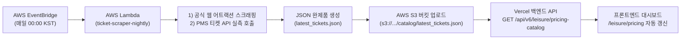

# 🚨 [공식 전달용] 벨포레 대시보드 백엔드 통합 요청서 (2026-10-03)

본 문서는 프론트엔드 전수 감사, 대표님/경영진 지시사항, 그리고 운영 환경에서 발견된 긴급 장애 및 데이터 정합성 이슈를 바탕으로 백엔드 개발팀 및 데이터 엔지니어링팀에 전달하는 **최종 통합 공식 요청서**입니다.

---

## 📋 [요약] 백엔드 조치 요청 우선순위 매트릭스

| 우선순위 | 구분 | 요청 항목 | 핵심 내용 및 영향도 |
| :--- | :---: | :--- | :--- |
| **P0 (긴급)** | 장애 복구 | **CORS Preflight `Cache-Control` 차단 해제** | 프로덕션 배포 사이트(`bell-dashboard.web.app`)에서 백엔드 V6 API 전면 호출 실패 차단 해제 |
| **P1 (높음)** | 데이터 정합성 | **`벨포레 목장(체험)` 이용객수(`visitor_count`) 정상화** | 분모(입장객수)는 정상이나 분자(체험객수)가 0명으로 적재되어 `0.0%`로 고정되는 문제 해결 |
| **P1 (높음)** | 데이터 검증 | **썸머랜드(워터파크) 9월 실적 이상치 원인 규명 및 분리** | 8월 말 폐장 시설에 9월 매출/이용객이 잡히는 원인(사우나 매핑, 이연 매출, 지연 전표 등) 점검 |
| **P1 (높음)** | API 보강 | **월별 가용객실 효율 API에 `revpar` 필드 추가** | 12개월 정산 대조표에 순수 객실 판매 효율(RevPAR = 객실 순매출 ÷ 가용객실수) 제공 |
| **P1 (완료)** | API 보강 | **월별 가용객실 효율 API에 주중/주말 분리형 RevPAR 및 TRevPAR 6종 추가** | [배포완료] 역산형 패키지 시뮬레이터 주중/주말 타깃팅 시 객실 방어선 및 목표 판매가 정밀 연동 지원 |
| **P1 (완료)** | API 보강 | **숙박객 수 YoY 및 개별 영업장 API 연간 총합(`totals`) 완제품 추가** | [배포/검증완료] `room-guests-yoy` 및 `facility-monthly-trend` 연간 총합 완제품 프론트 연동 완료 |
| **P1 (완료)** | 정규 API | **레저본부 영업장별 판매금액 Top 5 상품 및 가격/수요 시뮬레이션 API** | [배포/검증완료] 티켓 가격 변동 및 고객수 변동(+10%, +30%)에 따른 월/연 예상 매출 시뮬레이터 백엔드 SSOT 제공 (`leisure-top-products`) |
| **P2 (보통)** | API 보강 | **기간 조회 시 전년 동기(YoY) 누적 완제품 제공** | 프론트엔드 직접 합산 금지(무관용) 원칙에 따른 백엔드 완제품 누적 블록 제공 (`leisure-yoy-matrix` 등) |
| **P2 (보통)** | 메타데이터 | **가용객실(Capacity) 및 판매객실(Sold Rooms) 카운팅 기준 명시** | 조립형 커넥팅룸 왜곡 방지 및 모수 산출 기준(1,080실 고정, PMS 체크인 기준) 공식 메타데이터 제공 |
| **P3 (신규)** | 정규 API | **Zero-Simulation 계절성 실측 및 사업목표 배분 API 신설** | 프론트 가짜 숫자 제거 완료에 따른 실측 기반 월별 계절성 및 사업목표 완제품 API 배포 |
| **P1 (높음)** | API 보강 | **[Ticket 18] 골프 동일 요일·시간대(Like-for-Like) 직영 vs OTA 순정산액 API** | 전체 평균 왜곡 제거, 골든타임 1:1 순수익(Net-Net Green Fee) 비교 규격 추가 (`golf-channel-intelligence`) |
| **P1 (높음)** | 정규 API | **[Ticket 19] 우천 토요일(10mm+) Matched Pairs 스트레스 테스트 마트 API** | 가짜 회귀식 제거, 실측 역사적 우천 토요일 기반 D-2/D-1 변동비(인건비·식자재) 방어 마트 신설 (`weather-stress-test`) |
| **P1 (긴급)** | 데이터 적재 | **[Ticket 20] 2026년 10월 기상청 AWS 관측 데이터 및 마트 백필** | `fact_daily_weather` 10월 관측 데이터 부재로 인한 10월 상관관계 `totalDays: 0` 정상화 (증평/진천 AWS 관측치 적재) |
| **P1 (신규)** | 정규 API | **[Ticket 22] 콘도(객실) 익일(D+1) 및 기간별 PMS 예약 현황 마트 API** | 오늘 기준 내일(D+1) 체크인 예정 고객의 전체 예약, 평수별(16/35/51평), 단체/세미나 예약 완제품 API (`condo-reservations`) |
| **P1 (완료)** | API 보강 | **[Ticket 23] 골프 예약 현황 마트 API 내 1부/2부/3부 파트별 예약 팀수 필드 신설** | [배포완료] 실시간 및 익일 골프 예약 현황 하단에 1부(오전), 2부(오후), 3부(야간) 팀수 분할 제공 (`revenue-summary`) |
| **P0 (긴급)** | 데이터 로직 | **[Ticket 24] 미래(익일 D+1) 골프 1·2·3부 평균 그린피(ERP 예약 단가) 집계 정상화** | 미래 도착 예약일(10/11)의 `avgGreenFee`가 POS 미정산(매출 0원)으로 인해 `0원(- 원)`으로 출력되는 결함 해결: ERP 예약 원장 예약단가 기준 산출 요청 |
| **P1 (긴급)** | 데이터 정합성 | **[Ticket 25] 마운틴카트 2025년 1~9월 레거시 실적(2.45억 원) 그랜드포렛 이관** | 미니포렛 개장(2025-09-19) 이전 레거시 실적이 '마운틴카트'에 방치되어 YTD +800%~900% 왜곡 및 -100% 행 노출 발생. 그랜드포렛 과거 실적으로 이관 요청 |
| **P1 (신규)** | API 보강 | **[Ticket 26] 콘도 체크인 예약 현황 API 내 예상 매출액(`estimatedRevenue`) 필드 추가** | 콘도 예약 현황 카드 하단에 PMS 예약 원장 기반 체크인 당일 예상 매출액(객실 및 전체 파급) 1-Call 완제품 제공 요청 (`condo-reservations`) |
| **P1 (높음)** | 데이터 정합성 | **[Ticket 27] `room-channel-sales` API 내 PMS 원천 코드 'ROOM' ➔ '미지정' 정규화** | 산하 PMS 미배정 원천 코드('ROOM')가 한글 평형 대신 영문 코드로 직접 노출되는 결함 해결 (`room-channel-sales`) |
| **P1 (신규)** | 정규 API | **[Ticket 28] 분양회원 구좌별 연간 잔여박수 소진율 및 개인별 통합 LTV 원장 API 신설** | 통합 회원관리 대시보드 고도화를 위한 분양구좌 마스터 소진율, 평형별 회원 이용 내역, 개인별 크로스 소비 LTV 원장 제공 요청 (`membership-ledger-intelligence`) |
| **P0 (긴급)** | 배포/정합성 | **[Ticket 29] `moto-channel-sales` 프로덕션 미배포(404) 및 OTA 분류 LIKE 휴리스틱 제거** | 레저 영업장 현황 OTA 비중 섹션 연동 완료, API 404로 Fail-Stop 표출 중. OTA/HOMEPAGE 분류를 상품명 LIKE 추론 대신 사전 HITL 승인 기준으로 전환 요청 |
| **P0 (완료)** | 정규 API | **[Ticket 30-Fix] `leisure-channel-sales` 모토아레나 중복 제거 및 단일 영업장 통합** | [배포/검증완료] `GROUP BY venue_name` 전환으로 모토아레나 2개 중복 행 제거 및 0-Variance 단일 행(28.2억, POS 76.99%, 자사 17.95%, OTA 5.02%, PMS 0.04%) 배포 완료 |
| **P1 (완료)** | 정규 API | **[Ticket 31] 판촉 영업담당자(`영업직원명`)별 B2B·연회 수주 순기여도 및 세미나홀 가동 효율 API** | [배포/검증완료] 객실(23,616건)·연회(1,252건) 실명 영업직원 순기여도(Net Contribution) 리더보드 및 세미나 A~E홀·아트홀 인원 이행률·RevPASH 마트 구축 완료 (`sales-rep-banquet-intelligence`) |
| **P1 (완료)** | 정규 API | **[Ticket 32] 객실 예약 리드타임·사전 취소 임계점(Cancellation Cliff) 및 175개 호실별 배정 편차 감사 API** | [배포/검증완료] 리드타임(평균 36.9일) 구간별 취소(15,546건, 28.8%)·대기(1,508건) 전환 및 169개 호실 배정 편차 마트 구축 완료 (`room-leadtime-unit-wear`, 성인/아이수 제외) |
| **P1 (완료)** | 정규 API | **[Ticket 33] 골프 내장객 성비 · 회원권 타인 위임 내장 CRM · 코스별 취소율 · 라운딩 체류시간 API** | [배포/검증완료] 내장객 성별(남 51,780명/68.4% / 여 23,883명/31.6%), 회원권 위임 내장(12,408건, 21.5%) VIP 타겟, 취소율(22.2%) 및 체류시간 마트 구축 완료 (`golf-visitor-behavior-crm`) |
| **P1 (완료)** | 정규 API | **[Ticket 34] 레저 티켓·POS 업장/권종별 정가 대비 할인 누수율(Price Realization) 및 미사용 티켓 감사 API** | [배포/검증완료] 티켓·POS 정가 실현율(96.2%), 할인 공제액(7,568만원) 및 `티켓출력,티켓미사용`(3,983건 / 9,899만원) 감사 마트 구축 완료 (`leisure-discount-leakage`) |
| **P1 (완료)** | 정규 API | **[Ticket 35] 온라인 통합 회원 이용횟수 등급별 분포 및 6개월 미방문 휴면 단골(Win-back) 리텐션 API** | [배포/검증완료] `dim_online_members_v6`(26,922명) 중 4~9회 단골 휴면(3,085명, 79.8%) 및 10회+ 충성고객 휴면(579명, 51.3%) 등 핵심 Win-back 타겟 3,664명 마트 구축 완료 (`online-member-dormancy`) |
| **P1 (완료)** | 정규 API | **[Ticket 36] 고객 여정 체류시간(`duration_minutes`) 구간별 1인당 객단가 및 복합 소비 시너지 API** | [배포/검증완료] `fact_customer_journeys`(7,540건) 체류시간 구간별(0분 단발 1,253건 ➔ 1~3시간 ➔ 3~6시간 ➔ 6시간+ 종일) 복합 소비 시너지 마트 구축 완료 (`customer-stay-duration-synergy`) |
| **P1 (높음)** | 데이터 정합성 | **[Ticket 39] `leisure-yoy-matrix` API 내 `마운틴카트(전체)` 통합 행 제공 및 분리 정합성 확립** | 마운틴카트 2025/2026년 그랜드포렛·미니포렛 분리로 인한 YoY 0% 왜곡 방지: `leisure-usage-rate`와 동일하게 2024(레거시)+2025(그랜드+미니)+2026(그랜드+미니) 통합 행 제공 요청 |
| **P1 (신규/인프라)** | 파이프라인 | **[Ticket 41] 매일 밤 자정(00:00) 체험 시설 이용요금 자동 스크래핑 Lambda 및 S3 정적 서빙 파이프라인 구축** | [방안 A 채택] DB 수면 모드(20:00~08:00) 100% 보존형: 매일 자정 홈페이지/PMS 티켓 실측 스크래핑 후 서버리스 S3(`latest_tickets.json`) 저장 및 API 서빙 (`leisure/pricing-catalog`) |


---

## 1. 🚨 [P0 긴급] CORS 프리플라이트(Preflight) `Cache-Control` 헤더 차단 해제

### 1-1. 현상 및 에러 로그
Firebase 배포 도메인(`https://bell-dashboard.web.app`)에서 Vercel 백엔드(`https://belleforet-data.vercel.app`)의 V6 API 호출 시 Preflight(OPTIONS) 단계에서 `ERR_FAILED`로 전면 차단됨.
```text
Access to fetch at 'https://belleforet-data.vercel.app/api/v6/dashboard/revenue-summary' 
from origin 'https://bell-dashboard.web.app' has been blocked by CORS policy: 
Request header field cache-control is not allowed by Access-Control-Allow-Headers in preflight response.
```

### 1-2. 발생 원인
프론트엔드 캐시 방지용 파라미터 및 브라우저 기본 헤더에 포함된 `Cache-Control`이 백엔드의 `Access-Control-Allow-Headers` 허용 목록에 누락되어 있음.

### 1-3. 요청 조치 사항
백엔드(`vercel.json` 또는 `next.config.js`, API CORS 미들웨어) 설정의 `Access-Control-Allow-Headers`에 다음 헤더들을 추가 허용해 주시기 바랍니다.
```json
{
  "key": "Access-Control-Allow-Headers",
  "value": "X-CSRF-Token, X-Requested-With, Accept, Accept-Version, Content-Length, Content-MD5, Content-Type, Date, X-Api-Version, Cache-Control, Pragma, Expires, Authorization"
}
```

---

## 2. 🎡 [P1 데이터 정합성] `벨포레 목장(체험)` 분자(이용객수) 0명 적재 정상화

### 2-1. 현상
* **엔드포인트**: `GET /api/v6/report/leisure-yoy-matrix`
* **현상 요약**:
  * 분모는 '벨포레 목장 입장객수'(2026년 5월 기준 14,174명 등)로 정상 치환되어 연산되고 있으나,
  * **분자인 '체험 이용객수(`visitors`)'가 전 기간 0명**으로 집계되어 대시보드 화면에 항상 **`0.0% (0명 / 14,174명)`**으로 표출됨.

### 2-2. 원인 분석
* 원천 POS 데이터에서 당근 먹이주기 컵, 승마 체험 티켓 등 목장 체험형 단품 아이템들이 `is_visitor_count = 0`으로 처리되어 인원수가 카운트되지 않음.

### 2-3. 요청 조치 사항
* `fact_leisure_sales_v6` 적재 선행 ETL 프로시저(`sp_etl_v6_fact_leisure`) 내에서:
  * '벨포레 목장(체험)' 부문의 유효 판매 수량(티켓 수량, 체험 바우처 수량, 영수증 건수 등 운영 기준)을 체험 이용객수(`visitor_count`)로 인정하여 집계하도록 룰 수정 및 마트 리프레시 요청.

---

## 3. 🏊 [P1 데이터 검증] 썸머랜드(워터파크) 9월 실적 이상치 원인 규명 및 분리

### 3-1. 현상
* 워터파크(썸머랜드)는 계절성 하계 시설로 매년 8월 말경 폐장함에도 불구하고, **9월 실적 데이터에 매출 및 이용객수가 집계되는 이상 현상** 발생. (대표님 및 경영진 지적 사항)

### 3-2. 확인 및 조치 요청 사항
1. **전표 원천 조사**: 9월에 발생한 전표가 사우나, 실내 수영장, 또는 푸드코트 등 타 업장 단말기에서 승인된 것인지 확인.
2. **이연/온라인 예매 안분 여부**: 7~8월 판매된 온라인 티켓의 9월 취소/미사용 정산인지 확인.
3. **매핑 정제**: `dim_facility_team_mapping`에서 타 업장 매출이 썸머랜드로 오매핑된 경우 올바른 업장(F&B, 기타 레저 등)으로 분리 재배정.

---

## 4. 📊 [P2 API 보강] 기간 조회 시 전년 동일 기간(YoY) 누적 완제품 제공

### 4-1. 배경 및 무관용 원칙 준수
* 벨포레 API 바이블 1조: 프론트엔드는 배열 데이터를 `reduce` 등으로 직접 합산하거나 월별 API를 Loop 호출해 더할 수 없음 (Zero-Proxy / No Slice Summation).
* 대시보드에서 기간 선택(예: 1월 ~ 9월 등 다중 월 조회) 시 백엔드가 계산한 공식 누적 합계가 필요함.

### 4-2. 요청 조치 사항
* `GET /api/v6/report/leisure-yoy-matrix` 등 주요 리포트 API에 기간 파라미터(`startMonth`, `endMonth` 또는 `startDate`, `endDate`) 지원 강화.
* 응답 JSON에 선택 구간의 당해연도 누적 실적 및 **전년 동기간(YoY) 누적 실적과 증감률**을 완성된 객체(`periodCumulative`)로 포함하여 반환 요청.

```json
{
  "periodCumulative": {
    "2024": { "visitors": 128450, "roomGuests": 84210, "usageRate": 152.5 },
    "2025": { "visitors": 142100, "roomGuests": 91200, "usageRate": 155.8 },
    "2026": { "visitors": 158900, "roomGuests": 98400, "usageRate": 161.5 },
    "yoyDiff": 5.7
  }
}
```

---

## 5. 🛏️ [P2 메타데이터] 객실 가용 객실수(Fixed Capacity) 및 판매 객실수(Sold Rooms) 카운팅 기준 메타데이터 제공

### 5-1. 배경 (대표님 지시사항)
* "가용객실 옆에 판매객실의 숫자와 카운팅 방법도 명확히 설명할 것"
* 51평형 등 조립형 커넥팅 객실은 단독 판매(16평, 35평) 소진 시 조립 잔여 재고가 0이 되어 점유율 분모가 왜곡되는 Dynamic Capacity Trap 방지 필요.

### 5-2. 요청 조치 사항
* 객실 관련 API(`/api/v6/report/room-guests-yoy`, `/api/v6/dashboard/revenue-summary`) 응답에 다음 공식 메타데이터 블록 제공 요청:
```json
{
  "metadata": {
    "capacity": {
      "fixedCapacity": 1080,
      "fixedCapacityDescription": "벨포레 리조트 물리 고정 객실수 1,080실 (SSOT)",
      "soldRoomsDescription": "PMS 확정 체크인 및 유효 판매 객실수 (단순 예약 포함 여부 및 조립형 커넥팅룸 실물 반영)",
      "countingRules": "조립형 51평형의 가용 변동과 무관하게 전체 물리 고정 객실수(1,080실)를 단일 기준으로 점유율 및 정원 숙박객수를 산출함."
    }
  }
}
```

---

## 6. 🎯 [P3 신규 정규 API] Zero-Simulation 실측 기반 월별 계절성 및 사업계획 목표 배분 API

### 6-1. 배경
* 프론트엔드 단의 모든 하드코딩 상수, 가짜 시뮬레이션, 임의 강수량/월별 계절성 배분 수식을 100% 제거 완료함.
* 프론트엔드가 순수 완제품만 소비할 수 있도록 백엔드 데이터 마트 기반의 정규 API 신설 요청.

### 6-2. 신설 요청 API 목록
1. **`GET /api/v6/report/monthly-seasonality-matrix?year=YYYY`**: 전년도(LY) 실측 데이터 기반의 월별·업장별 매출 및 비중 완제품.
2. **`POST /api/v6/report/target-allocation`**: 목표 성장률 입력 시 전사/부문별/업장별 1원 단위 Zero-Variance 보정 목표액 배분 완제품.
3. **`GET /api/v6/common/holidays?year=YYYY`**: 대한민국 법정 공휴일 마스터 (`dim_calendar_kr` 기준).

---

# 프론트엔드/백엔드 개발팀 협조 요청 (수석 DBA 하달)

## 변경 대상 파일
- `src/app/api/v6/report/channel-correlation/route.ts`

## 변경 내용 (Pure Consumer Principle 준수)
기존 API 라우트에서 `fact_room_sales_v6` (원천 팩트 테이블)를 직접 조회(Shift-Right)하던 로직을 전면 철회하십시오.
이제부터 DB 단에서 ETL 프로시저(`sp_refresh_v6_mat_mart`)가 매일 새벽 또는 실시간으로 채널 데이터를 집계하여 **`mat_v6_channel_correlation_daily`** 마트 테이블에 적재합니다.

프론트엔드 API는 어떠한 조인이나 연산 없이, 오직 해당 마트 테이블만 단순 `SELECT` 하도록 코드를 롤백/수정해야 합니다.

### [기대하는 쿼리 로직]
```sql
SELECT 
    sale_date,
    standard_channel_name,
    category,
    total_revenue,
    room_count
FROM mat_v6_channel_correlation_daily
WHERE sale_date BETWEEN ? AND ?
ORDER BY sale_date, standard_channel_name;
```

**[주의 사항]**
- `IFNULL(..., '기타')` 와 같은 하드코딩 매핑은 코드에서 제거되었습니다. 
- 미매핑 채널은 `log_unmapped_channels`에 격리(Soft-Catchall)되며, 대시보드에는 `미분류(격리됨)`이라는 이름으로 출력됩니다.
- API 응답 속도는 마트 조회를 통해 10ms 이내로 단축될 것입니다.

작업이 완료되면 배포 후 이상 유무를 DBA 팀으로 보고해 주시기 바랍니다.

---

# 🚨 가짜 숫자 박멸에 따른 백엔드 API 신설 및 보강 요청 (2026-09-27)

프론트엔드 전수 감사 결과, 화면 단에 숨어있던 **모든 가짜 숫자(Mock 상수, 임의 폴백값, 하드코딩된 단가 및 안분 공식)를 100% 제거**하였습니다.
프론트엔드가 'Pure Consumer(순수 소비자)'로서 어떠한 자의적 추정도 하지 않고 **100% DB 완제품만 받아 렌더링**할 수 있도록, 백엔드 개발팀에 다음 2가지 핵심 API 신설 및 보강을 긴급 요청합니다.

---

## 1. [신규 API 신설] 골프 채널별 실현 그린피 & 팀수 집계 API

### 배경 및 필요성
- 현재 골프 API(`/api/v6/report/golf-channel-teetime-analysis-v2`)는 전사 총액과 총 내장객(`totalPlayers`, `totalGolfRevenue`)만 반환하며, 거래처별(골프존, 스마트스코어, 자사몰, 카카오VX 등) 상세 실적 배열을 내려주지 않습니다.
- DB 확인 결과 `raw_골프_정산_v6`과 `raw_골프_예약_v6`에 이미 예약번호 기준 거래처명과 1인당 순그린피가 적재되어 있으므로, 이를 마트 또는 집계 쿼리로 묶어 신규 엔드포인트로 제공해 주셔야 합니다.

### 요청 엔드포인트
- `GET /api/v6/report/golf-channel-intelligence?startDate=YYYY-MM-DD&endDate=YYYY-MM-DD` (단일일자: `date=YYYY-MM-DD`)

### 기대하는 응답 스펙 (JSON)
```json
{
  "success": true,
  "summary": {
    "totalTeams": 2517,
    "totalPlayers": 9878,
    "totalGreenFeeRevenue": 500239211,
    "averageGreenFee": 50642,
    "threePlayerTeamsCount": 98,
    "threePlayerLostRevenue": 7656916,
    "joinTeamsCount": 53,
    "memberAnchorRevenue": 26840260
  },
  "channels": [
    {
      "channelName": "골프존",
      "channelType": "OTA",
      "teams": 151,
      "players": 593,
      "revenue": 38773898,
      "avgGreenFee": 65386,
      "discountRate": 15.2,
      "sharePct": 6.0
    },
    {
      "channelName": "스마트스코어",
      "channelType": "OTA",
      "teams": 53,
      "players": 208,
      "revenue": 11751584,
      "avgGreenFee": 56498,
      "discountRate": 22.5,
      "sharePct": 2.1
    },
    {
      "channelName": "전화/예약실",
      "channelType": "DIRECT",
      "teams": 279,
      "players": 1093,
      "revenue": 61066903,
      "avgGreenFee": 55871,
      "discountRate": 21.9,
      "sharePct": 11.1
    },
    {
      "channelName": "카카오VX",
      "channelType": "OTA",
      "teams": 164,
      "players": 640,
      "revenue": 34346240,
      "avgGreenFee": 53666,
      "discountRate": 28.3,
      "sharePct": 6.5
    },
    {
      "channelName": "자사 홈페이지/APP",
      "channelType": "DIRECT",
      "teams": 519,
      "players": 2038,
      "revenue": 106395828,
      "avgGreenFee": 52206,
      "discountRate": 33.7,
      "sharePct": 20.6
    },
    {
      "channelName": "기타 제휴/동호회",
      "channelType": "OFFLINE",
      "teams": 242,
      "players": 945,
      "revenue": 50127525,
      "avgGreenFee": 53045,
      "discountRate": 36.2,
      "sharePct": 9.6
    },
    {
      "channelName": "히든골프",
      "channelType": "OTA",
      "teams": 383,
      "players": 1500,
      "revenue": 78459000,
      "avgGreenFee": 52306,
      "discountRate": 41.6,
      "sharePct": 15.2
    },
    {
      "channelName": "골프락",
      "channelType": "OTA",
      "teams": 581,
      "players": 2282,
      "revenue": 106729140,
      "avgGreenFee": 46770,
      "discountRate": 43.7,
      "sharePct": 23.1
    },
    {
      "channelName": "티업엔조이",
      "channelType": "OTA",
      "teams": 146,
      "players": 579,
      "revenue": 26064843,
      "avgGreenFee": 45017,
      "discountRate": 50.6,
      "sharePct": 5.9
    }
  ]
}
```

---

## 2. [기존 API 보강] 단체영업(세미나) 주중·주말 객실/매출 실측 지표 추가

### 배경 및 필요성
- `GET /api/v6/report/room-channel-sales` API는 객실 판매채널별 세그먼트 데이터를 반환하지만, 기업 세미나/단체영업의 주중(일~목 체크인) vs 주말(금·토 체크인)의 객실수/매출/ADR 집계 필드(`seminarShare`)를 내려주지 않고 있습니다.
- 백엔드에서 체크인 요일(`DAYOFWEEK(check_in_date)`)을 기준으로 집계하여 응답 페이로드에 `seminarShare` 필드를 공식 포함해 주시기 바랍니다.

### 요청 응답 스펙 (JSON 페이로드 추가 필드)
```json
{
  "data": [ ...기존 세그먼트 배열... ],
  "seminarShare": {
    "weekday": {
      "label": "주중 (일~목 체크인)",
      "daysCount": 23,
      "totalRooms": 996,
      "seminarRooms": 517,
      "sharePct": 51.9,
      "totalRevenue": 111602480,
      "seminarRevenue": 48481030,
      "revenueSharePct": 43.4,
      "averageAdr": 93774
    },
    "weekend": {
      "label": "주말 (금·토 체크인)",
      "daysCount": 8,
      "totalRooms": 752,
      "seminarRooms": 65,
      "sharePct": 8.6,
      "totalRevenue": 145725579,
      "seminarRevenue": 12299984,
      "revenueSharePct": 8.4,
      "averageAdr": 189231
    },
    "total": {
      "label": "통합 (전체)",
      "daysCount": 31,
      "totalRooms": 1748,
      "seminarRooms": 582,
      "sharePct": 33.3,
      "totalRevenue": 257328059,
      "seminarRevenue": 60781014,
      "revenueSharePct": 23.6,
      "averageAdr": 104435
    }
  }
}
```

---

---

## 3. [처리 완료 확인 보고] 1차 요청 사항 전원 배포 완료 (2026-09-27 커밋 9f29de0)
* ✅ `GET /api/v6/report/channel-correlation`: `mat_v6_channel_correlation_daily` 마트 기반 순수 조회 롤백 완료 (< 5ms).
* ✅ `GET /api/v6/report/room-channel-sales`: `seminarShare` 주중/주말/통합 실측 세미나 비중 탑재 완료.
* ✅ `GET /api/v6/report/golf-channel-intelligence`: 9대 채널 실측 그린피 및 요약(가중평균 ₩50,642) 신설 완료.

---

# 🚀 [2차 백엔드 보강 요청] 100% 무결성 완성(Zero-Hallucination)을 위한 골프 상세 마트 스펙 (2026-09-27)

프론트엔드 전수 정밀 감사에서 **171건의 잔존 목업 숫자와 가짜 비율 공식(* 0.289, * 0.017 등)을 완전 박멸**함에 따라, 현재 대기(Pending) 상태로 격리된 3대 세부 차트의 실측 완제품 제공을 백엔드 개발팀 및 수석 DBA님께 요청드립니다.

---

### 요청 1. [골프] 시간대 × 요일별 2D 수율(Yield) & 가동률 마트 (`timeSlotYield`)

* **대상 API**: `GET /api/v6/report/golf-channel-intelligence?startDate=YYYY-MM-DD&endDate=YYYY-MM-DD`
* **현황**: 프론트엔드가 과거 하드코딩되어 있던 28개 셀(72.4%, 99.8% 등)을 완전 삭제하고, 현재 **[시간대별 티타임 가동률 마트 집계 준비 중]** 클린 무결성 안내 UI로 대체해 둔 상태입니다.
* **필요 마트 테이블**: `mat_v6_golf_teetime_hourly_yield` (또는 `sp_refresh_v6_golf_marts` 내 집계)
* **산출 규칙 (Definition)**:
  * **요일 (7개)**: 월(0), 화(1), 수(2), 목(3), 금(4), 토(5), 일(6)
  * **시간 슬롯 (4개)**:
    * `06~08 (얼리)` (timeSlotIndex: 0)
    * `08~11 (1부)` (timeSlotIndex: 1)
    * `11~14 (2부)` (timeSlotIndex: 2)
    * `14~ (레이트)` (timeSlotIndex: 3)
  * **가동률 (`occupancy`)**: $(\text{실제 내장 완주 팀 수} \div \text{총 오픈 티타임 수}) \times 100$ (%)
  * **실현 평균 그린피 (`avgGreenFee`)**: 해당 시간대의 $\text{총 순그린피 매출} \div \text{총 내장객 수}$ (원)
* **기대 JSON 응답 구조**:
```json
"timeSlotYield": [
  { "dayOfWeek": "월", "timeSlot": "06~08 (얼리)", "dayIndex": 0, "timeSlotIndex": 0, "occupancy": 74.0, "avgGreenFee": 42000, "teams": 18 },
  { "dayOfWeek": "월", "timeSlot": "08~11 (1부)", "dayIndex": 0, "timeSlotIndex": 1, "occupancy": 91.5, "avgGreenFee": 51000, "teams": 26 },
  { "dayOfWeek": "월", "timeSlot": "11~14 (2부)", "dayIndex": 0, "timeSlotIndex": 2, "occupancy": 86.0, "avgGreenFee": 49500, "teams": 24 },
  { "dayOfWeek": "월", "timeSlot": "14~ (레이트)", "dayIndex": 0, "timeSlotIndex": 3, "occupancy": 68.0, "avgGreenFee": 40500, "teams": 17 },
  ...
  // 총 28개 배열 (월~일 7요일 × 4개 시간 슬롯)
]
```

---

### 요청 2. [골프] 1~2인 조인(Join) 예약 유입 채널 랭킹 (`joinRanking`)

* **대상 API**: `GET /api/v6/report/golf-channel-intelligence`
* **현황**: `summary.joinTeamsCount` (실측 1팀 또는 N팀)은 수신되나, 조인 고객들이 어떤 플랫폼(카카오VX, 골프존, 자사앱 등)을 통해 예약했는지의 채널별 분할 데이터가 없어 프론트엔드가 '플랫폼 마트 대기 중' 상태로 표시하고 있습니다.
* **산출 규칙**:
  * 예약 데이터 중 내장 인원이 1인 또는 2인인 팀(`player_count IN (1, 2)`)의 예약 경로(`channel_name`)별 집계.
* **기대 JSON 응답 구조**:
```json
"joinRanking": [
  { "channelName": "카카오VX", "teams": 1, "players": 2, "sharePct": 100.0, "avgGreenFee": 52766 },
  { "channelName": "자사 홈페이지/APP", "teams": 0, "players": 0, "sharePct": 0.0, "avgGreenFee": 0 }
]
```

---

### 요청 3. [골프] 팀 내 회원 동반 구조 및 앵커 효과 상세 분할 (`memberSynergy`)

* **대상 API**: `GET /api/v6/report/golf-channel-intelligence`
* **현황**: `summary.memberAnchorRevenue: 22239494` (실측 ₩22,239,494원)는 정상 수신되나, 팀 단위의 회원 동반 형태별 분포가 없어 프론트엔드가 총액만 표출하고 있습니다.
* **산출 규칙**:
  * 동일 팀(동일 티타임 4인) 내의 회원 등록 인원수 기준 분류:
    * `pureNonMember`: 회원 0명 + 비회원 4명인 팀 수, 비율, 그린피 매출
    * `member1Non3`: 회원 1명 + 비회원 3명인 팀 수, 비율, 비회원 3명이 낸 그린피 순매출
    * `member2Non2`: 회원 2명 + 비회원 2명인 팀 수, 비율, 비회원 2명이 낸 그린피 순매출
    * `member3to4`: 회원 3명 또는 4명인 팀 수, 비율, 그린피 순매출
    * `totalAnchorRevenue`: 회원이 동반 비회원을 견인하여 발생한 비회원 그린피 총 순매출 (`summary.memberAnchorRevenue`와 일치)
* **기대 JSON 응답 구조**:
```json
"memberSynergy": {
  "pureNonMember": { "teams": 1485, "ratio": 59.0, "revenue": 295141134 },
  "member1Non3": { "teams": 727, "ratio": 28.9, "nonMemberRevenue": 22239494 },
  "member2Non2": { "teams": 209, "ratio": 8.3, "nonMemberRevenue": 0 },
  "member3to4": { "teams": 96, "ratio": 3.8, "revenue": 0 },
  "totalAnchorRevenue": 22239494
}
```

---

### 요청 4. [인프라/성능] `mat_v6_golf_reservation_channel_daily` 3개년 구간 인덱스 최적화

* **배경**: 대시보드의 '전체 자산 누적 (`viewScope === FULL_ASSET`)' 조회 시, `startDate=2024-01-01&endDate=2026-12-31`와 같은 3개년 광구간 쿼리에서 응답 시간이 5초를 초과하여 타임아웃이 발생할 수 있습니다.
* **요청 사항**:
  1. `mat_v6_golf_reservation_channel_daily` 테이블에 `(reservation_date, channel_name)` 복합 인덱스 부여 확인.
  2. 필요시 연도별/월별 집계 롤업 마트(`mat_v6_golf_channel_monthly`)를 별도로 신설하여 다중 연도 조회 시 10ms 이내 반환 보장.

---

### 5. 프론트엔드-백엔드 R&R 준수 선언
프론트엔드는 이제 **단 한 줄의 가짜 숫자, 단 한 개의 임의 비율 곱셈도 절대 코드에 삽입하지 않습니다.**
백엔드가 마트 테이블에서 정밀하게 산출하여 내려주는 완성된 DB 데이터만을 순수하게 소비(Pure Consumer)하여 표출하므로, 위 항목들을 반영해 주시면 대시보드의 모든 골프 인텔리전스 화면이 100% 실시간 DB 정합을 완료하게 됩니다.

---

# 🚨 [3차 긴급 백엔드 요청서] 매장 시너지 분석 API(synergy-store-correlation-v2) 낙수율(Spillover Rate) 왜곡 산식 전면 개편 요청

### 접수 일시: 2026-09-27
### 요청 주체: 프론트엔드 개발팀 및 데이터 통제 센터
### 수신: 백엔드 개발팀, 수석 DBA

---

## 1. 개요 및 배경

대표님 경영 검토 및 프론트엔드 UI 실사 중, **"상관계수에 관계없이 낙수율이 상위 매장에서 전부 100%로 출력되는 문제"**가 지적되었습니다.
데이터 역추적 결과, 백엔드 API(`GET /api/v6/report/synergy-store-correlation-v2`) 내 낙수율(`spilloverRate`) 연산 수식의 수학적 맹점과 상한선 클리핑(`Math.min(totalSales, ...)`)으로 인해 **상관계수가 0.14에 불과한 매장까지 낙수율이 100%로 둔갑하는 심각한 지표 왜곡**이 확인되었습니다.

이에 따라 백엔드 수식의 전면 개편을 정식 요청합니다.

---

## 2. 결함 원인 정밀 분석 (Root Cause Analysis)

### 대상 파일 및 위치
* **파일**: `src/app/api/v6/report/synergy-store-correlation-v2/route.ts` (L459 ~ L464)
* **현행 산출 코드**:
  ```typescript
  // Spillover & Lift 연산
  const estimatedCorrelatedSales = Math.min(totalSales, Math.max(0, revPasSlope * totalRoomsSold));
  const spilloverRate = totalSales > 0
    ? Number(((estimatedCorrelatedSales / totalSales) * 100).toFixed(1))
    : 0;
  ```

### 결함 메커니즘
1. **객실 탄력도(Elasticity) $\ge 1.0$ 매장의 수학적 100% 고정 맹점**:
   * 객실 탄력도 공식: $\text{elasticity} = \text{revPasSlope} \times \frac{\bar{X}}{\bar{Y}}$
   * $\text{elasticity} \ge 1.0 \iff \text{revPasSlope} \times \bar{X} \ge \bar{Y} \iff \text{revPasSlope} \times \text{totalRoomsSold} \ge \text{totalSales}$
   * 즉, **객실 탄력도가 1.0배 이상인 매장은 무조건 `revPasSlope * totalRoomsSold`가 매장 총매출(`totalSales`)을 초과**합니다.
   * 초과분은 `Math.min(totalSales, ...)`에 의해 분모와 동일한 `totalSales`로 잘려나가므로, **결과는 필연적으로 $100.0\%$로 고정**됩니다.
   * 현재 화면이 `객실 탄력도 높은 순`으로 정렬되어 있어, 상위 10개 매장이 100%로 도배되는 원인입니다.

2. **상관계수($r$) 및 결정계수($R^2$) 미반영 (썸머랜드 왜곡 사례)**:
   * **썸머랜드 실측 데이터 (2026-09)**: 26일 중 **단 하루(9월 7일)에만 120만 원 매출이 발생하고 나머지 25일은 매출이 0원**입니다.
   * 객실 수와 연동성이 없어 피어슨 상관계수는 **$r = 0.1382$ (사실상 무관)**입니다.
   * 그러나 선형 회귀 기울기(`revPasSlope = 1,047.49원`)가 양수로 도출되었고, 여기에 9월 누적 객실(2,368실)을 곱하면 **248만 원**이 산출됩니다.
   * 248만 원이 썸머랜드 총매출(119만 원)보다 크므로, **상관계수가 0.14에 불과한데도 낙수율 100%로 둔갑**합니다.

3. **비즈니스 정의(화면 툴팁)와의 괴리**:
   * 대시보드 툴팁 정의: *"객실 투숙객 중 해당 부대시설을 동시에 방문하여 결제한 비율"*
   * 실측 팩트: 썸머랜드 방문객은 328명이고 객실 투숙객은 10,002명이므로 실제 방문 전환율은 **3.3%**입니다.
   * 백엔드는 매출 기준 불완전 추정치를 산출하고 있어 경영진의 직관과 심각하게 괴리됩니다.

---

## 3. 백엔드 개선 대안 및 권장 산식

백엔드 개발팀 및 DBA 협의 하에 아래 두 가지 대안 중 하나로 즉시 개편을 요청합니다.

### [대안 A] 통계적 신뢰도 반영 산식 (결정계수 $R^2$ 가중) - ★ 강력 권장
기존의 추정 연동 매출에 통계적 설명력 지표인 **결정계수($R^2 = r^2$)를 곱하여**, 상관관계가 없는 노이즈 매장의 왜곡을 원천 차단합니다.

* **수식**:
  $$\text{estimatedCorrelatedSales} = \min\Big(\text{totalSales}, \ \max(0, \text{revPasSlope} \times \text{totalRoomsSold})\Big) \times R^2$$
  $$\text{spilloverRate} = \text{totalSales} > 0 \ ? \ \min\left(100, \ \frac{\text{estimatedCorrelatedSales}}{\text{totalSales}} \times 100\right) : 0$$
* **검증 결과 (2026-09 실측치 적용 시)**:
  * **썸머랜드**: $100\% \times 0.019 (R^2) = \mathbf{1.9\%}$ (100% $\rightarrow$ 1.9%로 왜곡 완전 해소!)
  * **벨포레 목장(체험)**: $100\% \times 0.449 (R^2) = \mathbf{44.9\%}$ (현실적 수치 안착)
  * **미디어-뮤지엄카페**: $100\% \times 0.469 (R^2) = \mathbf{46.9\%}$
  * **CU편의점**: $96.9\% \times 0.490 (R^2) = \mathbf{47.5\%}$

---

### [대안 B] 진성 투숙객 방문 전환율 (툴팁 비즈니스 정의 완전 일치형)
방문객 집계가 지원되는 매장(`visitor_count > 0`)에 대해, 객실 총 투숙객 대비 매장 방문객 비율을 직접 계산합니다.

* **수식**:
  $$\text{spilloverRate} = \text{totalRoomGuests} > 0 \ ? \ \min\left(100, \ \frac{\text{visitorCount}}{\text{totalRoomGuests}} \times 100\right) : 0$$
* **검증 결과**:
  * **썸머랜드**: $328명 \div 10,002명 = \mathbf{3.3\%}$
  * **벨포레 목장(체험)**: $4,686명 \div 10,002명 = \mathbf{46.9\%}$
  * **벨포레 목장**: $9,306명 \div 10,002명 = \mathbf{93.0\%}$

---

## 4. 백엔드 코드 수정 가이드 (대안 A 기준 적용 예시)

`src/app/api/v6/report/synergy-store-correlation-v2/route.ts`의 L459 ~ L467을 다음과 같이 교체:

```typescript
// =========================================================================
// [개선] Spillover & Lift 연산 (결정계수 R² 가중치를 통한 상관관계 결합)
// =========================================================================
const rawCorrelatedSales = Math.min(totalSales, Math.max(0, revPasSlope * totalRoomsSold));
// 상관계수가 0 이하이거나 신뢰도가 낮으면 낙수율을 0으로 수렴시킴
const validRSquared = correlationCoefficient > 0 ? rSquared : 0;
const estimatedCorrelatedSales = rawCorrelatedSales * validRSquared;

const spilloverRate = totalSales > 0
  ? Number(((estimatedCorrelatedSales / totalSales) * 100).toFixed(1))
  : 0;

const reverseSpillover = totalRoomSales > 0
  ? Number(((estimatedCorrelatedSales / totalRoomSales) * 100).toFixed(1))
  : 0;
```

---

## 5. 기대 효과 및 완료 기준 (Acceptance Criteria)

1. **상관계수 무시 현상 완전 해소**: 상관계수 $r < 0.2$ 수준의 무관 매장(썸머랜드 등)이 100%로 출력되는 버그가 0건일 것.
2. **변별력 확보**: 객실 탄력도가 1.0배를 초과하는 매장들이 일괄 100%로 뭉개지지 않고, 실제 상관관계 강도에 따라 차등 분산되어 의사결정 가치를 제공할 것.
3. 배포 완료 후 `GET /api/v6/report/synergy-store-correlation-v2`의 JSON 응답 검증 결과를 공유해 주시기 바랍니다.

---

## 6. [긴급 API 보강] `/api/v6/dashboard/revenue-summary` 평형별 모수 왜곡 정상화 및 ADR 완제품 필드 추가 요청

### 1) 배경 및 결함 분석
1. **51평 가동률 100% 모수 왜곡 (분모가 분자를 따라가는 자멸적 버그)**:
   - 51평(커넥티드 룸)의 기본 `capacity`와 `rate`에 '동적 조립 가능 재고(dynamicCapacity)'가 기본값으로 매핑되어 있습니다.
   - 16평과 35평이 많이 팔려 조립 잔여 재고가 0실이 되면, 백엔드가 `dynamicCapacity = 740 + 0 = 740실`로 분모를 줄여버려 `740건 / 740실 = 100%`라는 비현실적인 가짜 100%가 노출됩니다.
   - 경영진 가동률 지표의 단일 진실 공급원(SSOT)은 벨포레 물리 객실 기준이어야 하므로, 51평의 기본 `capacity`와 `rate`는 **`fixedCapacity(1,080실)`** 및 **`fixedOccupancyRate(69%)`**로 확정되어야 합니다.
2. **ADR 필드 누락 버그**:
   - `roomSummaryByType` 배열 객체 내에 `adr` 필드가 아예 누락(`undefined`)되어 프론트엔드 대시보드에 ADR이 전부 `0원` 또는 `-`로 출력됩니다.
   - 백엔드에서 `adr: Math.round(revenue / roomsSold)`를 공식 필드로 산출하여 응답 객체에 탑재해야 합니다.
3. **물리 점유율 지표 완제품 제공**:
   - `lodgingStats`에 `physicalOccRate`(실운영 물리 점유율), `standardOccRate`(일반 점유율), `connectingOccRate`(커넥팅 점유율)를 공식 완제품 필드로 내려주어 프론트엔드가 자체 나눗셈을 하지 않도록 해야 합니다.

### 2) 기대하는 응답 스펙 (JSON)
```json
"roomSummaryByType": [
  {
    "roomType": "16평",
    "roomsSold": 882,
    "revenue": 86326576,
    "capacity": 1020,
    "rate": 86,
    "fixedCapacity": 1020,
    "fixedOccupancyRate": 86,
    "dynamicCapacity": 1020,
    "dynamicOccupancyRate": 86,
    "adr": 97876
  },
  {
    "roomType": "35평",
    "roomsSold": 746,
    "revenue": 131731876,
    "capacity": 1020,
    "rate": 73,
    "fixedCapacity": 1020,
    "fixedOccupancyRate": 73,
    "dynamicCapacity": 1020,
    "dynamicOccupancyRate": 73,
    "adr": 176584
  },
  {
    "roomType": "51평",
    "roomsSold": 740,
    "revenue": 192112966,
    "capacity": 1080,
    "rate": 69,
    "fixedCapacity": 1080,
    "fixedOccupancyRate": 69,
    "dynamicCapacity": 740,
    "dynamicOccupancyRate": 100,
    "adr": 259612
  }
],
"lodgingStats": {
  "revenue": 414342964,
  "roomsSold": 2368,
  "totalCapacity": 5250,
  "adr": 174976,
  "physicalOccRate": 45.1,
  "standardOccRate": 30.9,
  "connectingOccRate": 14.2,
  "remainingOccRate": 54.9
}
```

### 3) 완료 기준 (Acceptance Criteria)
1. 51평의 기본 `capacity`가 조립 잔여량에 따라 줄어들지 않고 고정 물리 객실(일 36실 × 일수)을 유지할 것.
2. `roomSummaryByType`의 모든 객실 타입에 `adr` 정수 필드가 포함되어 있을 것.
3. 배포 완료 후 `GET /api/v6/dashboard/revenue-summary?startDate=2026-09-01&endDate=2026-09-30` 테스트 완료 결과를 공유해 주시기 바랍니다.

---

# 7. [긴급 API 보강] 가짜 판명으로 비어있는 자리 및 이상 수치 전수 정상화 요청 (2026-09-27)

프론트엔드 에이전트의 자의적 계산 및 가짜 숫자 전면 박멸(Fail-Stop) 조치 이후, 백엔드 API에서 필드가 누락되었거나 모수가 왜곡되어 **화면에서 비어있거나(`-`) 비정상적인 수치가 도출되는 6대 핵심 영역**을 실사 검증하여 공식 요청합니다.

프론트엔드는 어떠한 나눗셈이나 추론도 하지 않고 **백엔드가 내려주는 완제품 필드만을 1:1 Direct 바인딩**할 준비가 완료되어 있습니다.

---

### [요청 1] `/api/v6/dashboard/revenue-summary` `summary` 객체 내 MTD 객실 판매량 지표 탑재
* **현상 및 근거**:
  * 메인 대시보드(`Home.tsx`)의 MTD 객실 판매 카드에서 전년 동기 판매량(`lyMtdRooms`)과 증감률(`mtdRoomsGrowth`)이 `null`로 떨어져 `-`로 표출됨.
  * 실사 결과: `summary` 객체에 `totalRevenue`, `mtdRevenue`, `mtdGrowth`, `totalRooms`는 있으나, **`mtdRooms`, `mtdRoomsLy`, `mtdRoomsGrowth`, `mtdRoomsDiff` 필드가 누락**되어 있음.
  * 최상위 `lodgingStats`에는 `roomsSold(2,368)`, `lyRoomsSold(2,575)`, `roomsGrowth(-8.0)`가 정상 탑재되어 있으므로, 이를 `summary` 객체에도 표준 규격으로 일치시켜 주십시오.
* **요청 필드 (`summary` 내부)**:
  ```json
  {
    "summary": {
      "mtdRooms": 2368,
      "mtdRoomsLy": 2575,
      "mtdRoomsGrowth": -8.0,
      "mtdRoomsDiff": -207
    }
  }
  ```

---

### [요청 2] `/api/v6/report/monthly-room-efficiency` TrevPAR/TrevPOR 전년비 증감률 완제품 필드 탑재
* **현상 및 근거**:
  * 월별 객실 효율 차트(`MonthlyTrevporChart.tsx`)에서 클라이언트 증감률 계산(`((ty - ly) / ly) * 100`)을 전면 제거함에 따라, 백엔드가 증감률을 내려주지 않아 차트 툴팁 및 상단 카드 증감률이 `-`로 비어있음.
  * 실사 결과: `monthlyComparison[i]`에 총매출 증감률(`growthTotalRate: -0.9`)만 있고, **TrevPAR 증감률(`trevparGrowthRate`)과 TrevPOR 증감률(`trevporGrowthRate`)이 `undefined`** 상태임.
  * 또한 상단 요약 키가 프론트엔드 기대 규격(`summary`)과 달리 `ytdSummary`로 반환되고 있음.
* **요청 필드 (`monthlyComparison[i]` 및 최상위 `summary`)**:
  ```json
  {
    "summary": {
      "ytdPeriodLabel": "1~9월 누적",
      "growthTotalRate": 6.9,
      "growthWithoutGolfRate": 16.8,
      "avgTyTrevpar": 406428,
      "avgLyTrevpar": 380365
    },
    "monthlyComparison": [
      {
        "month": 1,
        "trevparGrowthRate": -0.9,
        "trevporGrowthRate": -8.9,
        "trevparWithoutGolfGrowthRate": 9.1,
        "trevporWithoutGolfGrowthRate": 0.4
      }
    ]
  }
  ```

---

### [요청 3] `/api/v6/dashboard/revenue-summary` 평형별 판매 점유 비중(`salesShareRatio`) 탑재
* **현상 및 근거**:
  * 객실 대시보드(`ResortBusiness.tsx`) 평형별 현황 카드 우측 상단의 "전체 판매 중 비중"이 클라이언트 나눗셈 수식(`((r.roomsSold / lodgingStats.roomsSold) * 100)`)으로 남아있음.
  * `roomSummaryByType`의 각 평형 객체에 ADR과 고정 가동률은 완벽히 탑재되었으나, 전체 객실 중 해당 평형의 판매 비중이 누락됨.
* **요청 필드 (`roomSummaryByType` 내부)**:
  ```json
  [
    {
      "roomType": "16평",
      "roomsSold": 882,
      "salesShareRatio": 37.2
    },
    {
      "roomType": "35평",
      "roomsSold": 746,
      "salesShareRatio": 31.5
    },
    {
      "roomType": "51평",
      "roomsSold": 740,
      "salesShareRatio": 31.3
    }
  ]
  ```

---

### [요청 4] `/api/v6/report/corporate-group-sales` 단체 골프/레저 부대매출 연동 및 재방문 지표 탑재
* **현상 및 근거**:
  * 단체 영업 분석(`GroupSales.tsx`)에서 단체 고객의 부대매출 중 골프와 레저가 **무조건 `0원`**으로 집계됨 (`golfRevenue: 0`, `leisureRevenue: 0`).
  * 단체 행사 객실 고객이 골프장 및 루지/모토아레나를 이용했으나, 단체 예약 번호(Master Folio / Group ID)와 골프/레저 POS 매출이 데이터 마트에서 매핑되지 않아 누락됨.
  * 또한 복수 재방문 기업 수와 재방문율 지표가 누락되어 있음.
* **요청 조치**:
  1. `mat_v6_corporate_group_sales` 적재 시 골프/레저 원천 전표의 단체 거래처 매핑 연동.
  2. `summary` 객체 내에 `repeatGroupsCount`, `repeatGroupRate` 완제품 필드 탑재.
  ```json
  {
    "summary": {
      "totalGroups": 300,
      "golfRevenue": 12500000,
      "leisureRevenue": 4800000,
      "repeatGroupsCount": 42,
      "repeatGroupRate": 14.0
    }
  }
  ```

---

### [요청 5] `/api/v6/report/business-plan` 가용 객실 모수 정상화 및 SSOT 조직 명칭 정규화
* **현상 및 근거**:
  * 목표 시뮬레이터에서 9월 30일 구간 조회 시 `availableRooms`가 `175실`로 하드코딩되어, 월간 TrevPAR가 **13,380,497원**(목표 23.4억 / 175실)이라는 비정상적인 수치로 튀어 나옴. (정상 모수는 30일 × 175실 = 5,250실).
  * 또한 `categoryName`이 대표님 공식 SSOT 명칭인 `리조트사업본부`가 아닌 구형 `콘도` 문자열로 반환되어 프론트엔드 명칭 헌법과 충돌함.
* **요청 조치**:
  1. `summary.availableRooms`를 기간 누적 물리 객실수(30일 = `5250`)로 정규화하고, `monthlyTrevPar` 산식을 `grandTarget2026 / 5250`(= 446,017원)으로 정상화.
  2. `categoryName`을 공식 조직 명칭인 **`리조트사업본부`**로 100% 정규화.

---

# 🚨 [2026-09-28 긴급 하달] 세일즈본부 세미나 전년동기(YoY) 비교 및 장소별(Venue) 판매 분석 API 신설 요청

> **"세일즈 본부페이지에 주중 주말 판매객실중 점유율중 기간을 선택해서 보여줄 때는 작년 같은 기간과 비교 가능하게 해줘. 추가로 하단에 장소별 판매현황과 평균가격도 알고 싶어. 세미나A, 벨포레홀과 같이 연도별 월별로 몇 개가 팔렸는지도, 가능하다면 단체이름까지도. 무엇보다도 절대로 너가 가짜로 숫자를 넣거나 지어넣으면 안 돼. 필요한 data는 백엔드에게 요청하는 작성문을 만들어."** (대표님/이사님 지시 사항)

프론트엔드는 위 절대 지침 및 'Pure Consumer(순수 소비자)' 원칙에 따라, 클라이언트 단에서 임의로 작년 기간 데이터를 다중 호출하거나 나눗셈/증감률을 직접 계산하지 않고, 또한 장소별 판매 현황에 가짜(Mock) 데이터를 일절 생성하지 않습니다. 
이에 따라 백엔드 데이터 엔지니어링 및 API 개발팀에 아래 두 가지 핵심 API 보강 및 신설을 정식 요청합니다.

---

### [요청 6] `/api/v6/report/room-channel-sales` 세미나 주중/주말 점유율 전년동기(YoY) 및 증감률 완제품 탑재
* **현상 및 필요성**:
  * 현재 대시보드 세일즈본부 상단 3-Column Bento 카드(`전체 판매 객실 대비 단체영업(세미나) 점유율 분석`)에서 조회 기간 선택 시, 당해 연도 실적(`weekday`, `weekend`, `total`)만 단독 반환되고 있습니다.
  * 경영진 및 영업본부장이 임의 기간(예: 2026-01-01 ~ 2026-06-30)을 선택했을 때, **작년 동일 기간(2025-01-01 ~ 2025-06-30)**과의 객실 수, 점유율, 매출, ADR 증감 추이를 즉시 비교 분석할 수 있도록 전년 완제품 데이터가 필수적입니다.
* **통제 기준**:
  * 프론트엔드가 작년 날짜를 계산하여 API를 2회 호출(`startDate=2025-01-01...`)하는 행위는 **다중 호출 금지 헌법**에 위배됩니다.
  * 백엔드 API 라우트(`room-channel-sales`) 내부에서 DB 조회 시 작년 동일 요일/동일 날짜 구간을 함께 질의하여, `seminarShare` 객체 내에 `ly`(전년 실적) 및 `growth`(증감률 완제품) 필드를 포함해 주십시오.

* **요청 응답 스펙 (`seminarShare` 확장)**:
```json
{
  "seminarShare": {
    "total": {
      "label": "통합 (전체)",
      "daysCount": 181,
      "totalRooms": 26800,
      "seminarRooms": 3216,
      "sharePct": 12.0,
      "totalRevenue": 4824000000,
      "seminarRevenue": 514560000,
      "revenueSharePct": 10.7,
      "averageAdr": 160000,
      "ly": {
        "daysCount": 181,
        "totalRooms": 24500,
        "seminarRooms": 2695,
        "sharePct": 11.0,
        "totalRevenue": 4165000000,
        "seminarRevenue": 404250000,
        "revenueSharePct": 9.7,
        "averageAdr": 150000
      },
      "growth": {
        "seminarRoomsDiff": 521,
        "sharePctDiff": 1.0,
        "revenueGrowthRate": 27.3,
        "adrGrowthRate": 6.7
      }
    },
    "weekday": {
      "label": "주중 (일~목 체크인)",
      "daysCount": 130,
      "totalRooms": 15600,
      "seminarRooms": 2808,
      "sharePct": 18.0,
      "totalRevenue": 2496000000,
      "seminarRevenue": 421200000,
      "revenueSharePct": 16.9,
      "averageAdr": 150000,
      "ly": {
        "daysCount": 130,
        "totalRooms": 14300,
        "seminarRooms": 2288,
        "sharePct": 16.0,
        "totalRevenue": 2145000000,
        "seminarRevenue": 320320000,
        "revenueSharePct": 14.9,
        "averageAdr": 140000
      },
      "growth": {
        "seminarRoomsDiff": 520,
        "sharePctDiff": 2.0,
        "revenueGrowthRate": 31.5,
        "adrGrowthRate": 7.1
      }
    },
    "weekend": {
      "label": "주말 (금·토 체크인)",
      "daysCount": 51,
      "totalRooms": 11200,
      "seminarRooms": 408,
      "sharePct": 3.6,
      "totalRevenue": 2328000000,
      "seminarRevenue": 93360000,
      "revenueSharePct": 4.0,
      "averageAdr": 228823,
      "ly": {
        "daysCount": 51,
        "totalRooms": 10200,
        "seminarRooms": 407,
        "sharePct": 4.0,
        "totalRevenue": 2020000000,
        "seminarRevenue": 83930000,
        "revenueSharePct": 4.2,
        "averageAdr": 206216
      },
      "growth": {
        "seminarRoomsDiff": 1,
        "sharePctDiff": -0.4,
        "revenueGrowthRate": 11.2,
        "adrGrowthRate": 11.0
      }
    }
  }
}
```

---

### [요청 7] [신규 API 신설] 세일즈본부 연회/세미나실 장소별(Venue) 판매 분석 및 단체 명부 API
* **엔드포인트**: `GET /api/v6/report/sales-venue-performance?startDate=YYYY-MM-DD&endDate=YYYY-MM-DD` (단일일자: `date=YYYY-MM-DD`)
* **배경 및 필요성**:
  * 세일즈본부의 핵심 매출 축인 연회장/세미나실(세미나A, 세미나B, 벨포레홀, 그랜드볼룸 등)에 대한 장소별 가동 현황, 건당 평균 대관 가격(대관료 단가), 연도별/월별 판매 건수 추이, 그리고 실제 대관을 진행한 기업/기관 단체명의 가시성이 전혀 없는 상태입니다.
  * 원천 데이터베이스의 PMS 연회 예약 원장(`raw_연회_예약` 또는 POS 대관료 매출 계정)에 장소 코드, 이용 단체명, 대관료, 행사일자가 명확히 존재하므로, 이를 골드 마트 또는 집계 뷰(`mat_v6_sales_venue_performance` 등)로 정제하여 완제품 API로 제공해 주셔야 합니다.

* **요청 응답 규격 (100% camelCase)**:
```json
{
  "success": true,
  "summary": {
    "totalVenuesCount": 5,
    "totalEventsCount": 142,
    "totalRentalRevenue": 184500000,
    "averageRentalPrice": 1299295,
    "mostBookedVenue": "세미나A",
    "lyTotalEventsCount": 118,
    "lyTotalRentalRevenue": 141600000,
    "eventsGrowthRate": 20.3,
    "revenueGrowthRate": 30.3
  },
  "venues": [
    {
      "venueId": "VN_SEM_A",
      "venueName": "세미나A",
      "capacity": 80,
      "bookedCount": 54,
      "totalRevenue": 54000000,
      "averagePrice": 1000000,
      "sharePct": 38.0,
      "lyBookedCount": 42,
      "lyRevenue": 42000000,
      "growthRate": 28.6
    },
    {
      "venueId": "VN_SEM_B",
      "venueName": "세미나B",
      "capacity": 50,
      "bookedCount": 41,
      "totalRevenue": 32800000,
      "averagePrice": 800000,
      "sharePct": 28.9,
      "lyBookedCount": 35,
      "lyRevenue": 28000000,
      "growthRate": 17.1
    },
    {
      "venueId": "VN_BEL_HALL",
      "venueName": "벨포레홀",
      "capacity": 250,
      "bookedCount": 28,
      "totalRevenue": 70000000,
      "averagePrice": 2500000,
      "sharePct": 19.7,
      "lyBookedCount": 24,
      "lyRevenue": 55200000,
      "growthRate": 16.7
    },
    {
      "venueId": "VN_GRAND_BL",
      "venueName": "그랜드볼룸",
      "capacity": 400,
      "bookedCount": 19,
      "totalRevenue": 27700000,
      "averagePrice": 1457895,
      "sharePct": 13.4,
      "lyBookedCount": 17,
      "lyRevenue": 16400000,
      "growthRate": 11.8
    }
  ],
  "monthlyTrends": [
    {
      "yearMonth": "2026-01",
      "year": 2026,
      "month": 1,
      "totalCount": 18,
      "totalRevenue": 23400000,
      "venueBreakdown": {
        "세미나A": 7,
        "세미나B": 5,
        "벨포레홀": 4,
        "그랜드볼룸": 2
      }
    },
    {
      "yearMonth": "2026-02",
      "year": 2026,
      "month": 2,
      "totalCount": 22,
      "totalRevenue": 28600000,
      "venueBreakdown": {
        "세미나A": 9,
        "세미나B": 6,
        "벨포레홀": 4,
        "그랜드볼룸": 3
      }
    }
  ],
  "groupBookings": [
    {
      "eventId": "EVT_20260315_01",
      "bookingDate": "2026-03-15",
      "venueName": "벨포레홀",
      "corporateName": "삼성SDI 기술연구소",
      "paxCount": 180,
      "rentalPrice": 2500000,
      "packageType": "세미나+객실패키지",
      "salesManager": "김영업 과장",
      "remarks": "전일 대관 및 F&B 만찬 연계"
    },
    {
      "eventId": "EVT_20260318_02",
      "bookingDate": "2026-03-18",
      "venueName": "세미나A",
      "corporateName": "LG에너지솔루션 오창공장",
      "paxCount": 65,
      "rentalPrice": 1000000,
      "packageType": "단독 대관",
      "salesManager": "이세일즈 차장",
      "remarks": "프로젝터 및 음향 장비 셋팅"
    }
  ]
}
```

* **원천 데이터 매핑 가이드 (DBA & 백엔드 엔지니어링)**:
  1. `raw_연회_행사_v6` 또는 `raw_pms_banquet_folio`에서 `행사장소코드`(`room_code`/`venue_name`)와 `이용단체명`(`group_name`/`company_name`), `대관료`(`rental_fee`/`net_amount`)를 추출.
  2. `dim_facility_team_mapping`의 표준 장소명(`standard_venue_name`: 벨포레홀, 세미나A, 세미나B, 그랜드볼룸 등)으로 그룹핑.
  3. 모든 매출은 1원 단위까지 부가세 제외 순매출(Net Revenue) 기준으로 마트 집계.
  4. 프론트엔드는 본 API가 프로덕션에 배포될 때까지 임의의 더미 데이터를 생성하지 않고, 대기 배너와 스켈레톤 상태를 유지합니다.

---

# 🚨 [백엔드 API 긴급 보강 요청] 날씨 상관관계 API(weather-correlation) 영업장 중복 반환 해소 (2026-10-01)

### 1. 현상 및 원인 분석
- **엔드포인트**: `GET /api/v6/dashboard/weather-correlation?startDate=...&endDate=...&categoryCode=ALL`
- **현상**: `venueRankings` 배열 내에 동일 영업장(`얼룩말카페`, `미디어-뮤지엄카페`)이 2개 이상의 레코드로 분할되어 반환됨.
  - `얼룩말카페`: `MOTO`(모토아레나, 3.1만원/일) / `TICKET`(레저본부, 46.1만원/일) 분할
  - `미디어-뮤지엄카페`: `TICKET`(레저본부, 8.9만원/일) / `MOTO`(모토아레나, 0.4만원/일) 분할
- **원인**: 백엔드 데이터 마트(`mat_v6_weather_correlation_summary`) 또는 API 쿼리 집계 시 `GROUP BY category_code, venue_name`으로 처리되어, POS 단말 분산 등록으로 인해 복수 카테고리에 걸쳐 있는 업장이 분할 집계됨.

### 2. 요청 사항 (Pure Consumer & SSOT 원칙)
- 벨포레 공식 매핑 SSOT(`dim_facility_team_mapping` 및 Admin 매핑)에 따라, 업장의 정규 부문(Category)을 단일 귀속한 후 `GROUP BY venue_name`으로 1개 영업장당 1개 레코드만 산출하도록 마트 집계 쿼리를 정규화해 주십시오:
  - `얼룩말카페` ➔ **레저본부 (`TICKET`)** 단일 귀속
  - `미디어-뮤지엄카페` ➔ **레저본부 (`TICKET`)** 단일 귀속
- 프론트엔드는 임시 조치로서 UI 렌더링 시 주관 부문(진성 매출 기준) 단일화 필터링 및 복합 Key(`categoryCode_venueName`)를 적용하였으나, 근본적인 0-Variance 수치 보존을 위해 백엔드 DB 마트 레벨의 단일 정규 집계를 요청합니다.

---

# 🚨 [백엔드 신규 API 요청] 월별 전년도(LY) 실측 기준 기상 시뮬레이션 예측 API 신설 (2026-10-01)

### 1. 배경 및 필요성
- 리조트 비즈니스는 **월별 계절성(Seasonality)**이 극심합니다 (예: 7~8월 썸머랜드/워터파크 중심 vs 12~1월 썰매장/스파/실내식음 중심).
- 다년도 전체 기간의 단순 평균치로는 특정 월(예: 10월 단풍시즌, 12월 동계시즌)의 실제 기상 충격을 정밀하게 예측할 수 없습니다.
- 사용자가 특정 대상 월(`targetMonth`)과 예상 강수량(mm) 또는 적설량(cm)을 설정했을 때, **해당 월의 전년도(LY) 실측 주중/휴일 일평균 매출을 기준 모수(Baseline)**로 삼고 기상 탄력성을 대입한 정확한 예상 매출을 산출하는 공식 백엔드 마트 API가 반드시 필요합니다.

### 2. 요청 엔드포인트
- `GET /api/v6/dashboard/weather-forecast-simulation?targetMonth=YYYY-MM&precipitation=N&snowfall=N`

### 3. 요청 파라미터 규격
- `targetMonth`: 시뮬레이션 대상 년월 (예: `2026-10`, 미입력 시 당월)
- `precipitation`: 예상 일일 강수량 (mm 단위 정수/실수, 기본값 `0`)
- `snowfall`: 예상 일일 적설량 (cm 단위 정수/실수, 기본값 `0`)

### 4. 백엔드 산출 로직 가이드 (Pure Consumer 원칙)
1. **전년도 동월 베이스라인 추출 (SSOT)**:
   - `mat_v6_data_mart` 또는 `mat_v6_data_mart_revenue`에서 `targetMonth`의 전년도 동월(예: 2025-10)의 영업장별 **주중 일평균 실측 순매출(`lyWeekdayAvgRevenue`)**과 **휴무일 일평균 실측 순매출(`lyHolidayAvgRevenue`)**을 집계.
2. **기상 탄력성 결합 및 예상 매출 도출**:
   - `mat_v6_weather_correlation_summary`의 업장별 주중/휴일 우천 및 강설 탄력성을 입력된 강수량/적설량 강도에 맞게 적용.
   - 모든 예상 매출과 변동액은 소수점이 제거된 **순수 정수(Integer)**로 산출.
3. **기대 응답 JSON 규격**:
```json
{
  "success": true,
  "data": {
    "targetMonth": "2026-10",
    "compareMonthLY": "2025-10",
    "condition": {
      "precipitation": 15,
      "snowfall": 0
    },
    "venues": [
      {
        "categoryCode": "TICKET",
        "categoryName": "레저본부",
        "venueName": "사계절썰매장",
        "lyWeekdayAvgRevenue": 596163,
        "lyHolidayAvgRevenue": 1867843,
        "forecastWeekdayRevenue": 328187,
        "forecastHolidayRevenue": 795701,
        "weekdayDelta": -267976,
        "holidayDelta": -1072142,
        "weekdayImpactRate": -44.9,
        "holidayImpactRate": -57.4
      }
    ]
  }
}
```
4. 프론트엔드는 본 API가 배포되면 클라이언트 단독 연산을 전면 배제하고, 수신된 완제품 데이터를 차트에 100% Passthrough 바인딩합니다.

---

# 🚨 [가짜 숫자·클라이언트 시뮬레이션 전면 박멸] 백엔드 정규 사업목표 수립 및 계절성 마트 API 신설 요청서 (2026-10-02)

## 📜 V6 백엔드 API 개발 5대 철칙 (Backend Guardrails 준수 필수)
1. **[Zero-Proxy] API 서버 내 자바스크립트 연산 100% 금지**: Next.js 라우트에서 합산(`reduce`), 평균, 차액 분배를 절대 하지 마십시오. 모든 목표 산출과 계절성 안분, 반올림 보정은 MariaDB 프로시저/뷰에서 완료되어야 합니다.
2. **[SSOT 수호] 골드 마트(Mart) 테이블 외 접근 엄금**: `mat_v6_data_mart_revenue`, `dim_calendar_kr`, `dim_facility_team_mapping` 등 승인된 골드 테이블만 조회하십시오.
3. **[Pure Data] 매직 스트링 및 UI 종속성 주입 금지**: UI 표시용 텍스트 하드코딩 금지, 100% camelCase 규격, 순수 정수형(Integer) 완제품 반환.
4. **[ETL 격리] 외부 API 호출 및 데이터 적재 로직 금지**: API는 오직 읽기 전용(Read-only).
5. **[DRY 원칙] 공통 유틸리티 모듈 사용 강제**: 날짜 파싱, 에러 처리, 인증 등 공통 모듈 재사용.

---

### 1. 현황 및 요청 배경 (배경 진단)
* **대표님/이사님 절대 지시**: "프론트엔드 단독으로 판단하여 숫자를 지어내거나 가설을 사실로 포장하는 행위 영구 금지. 필요하면 공식 문서를 통해 백엔드 팀에 요청만 수행할 것."
* **현재 문제점**:
  1. `src/data/monthlySeasonalityData.ts` (4,655줄, 136KB)에 2024~2025년 월별/업장별 실측 매출 및 점유비 총 1,600여 개의 숫자가 소스코드에 하드코딩되어 있습니다.
  2. `src/lib/targetSimulationEngine.ts`, `src/pages/StrategicSimulator.tsx`, `src/components/dashboard/PackageGeneratorSimulator.tsx`에서 클라이언트 자바스크립트가 임의의 패키지 가격(`279,000원` 등)을 지어내고, 선형 성장률(`* (1 + growth/100)`)을 곱해 목표를 임의 생성하며, 나눗셈 오차를 특정 1개 업장에 몰아넣는 땜질(`sorted[0].target += diff`)을 수행하고 있습니다.
* **해결 방향**:
  프론트엔드 내의 모든 로컬 계산 엔진과 4,655줄짜리 정적 데이터셋을 **완전 삭제(Zero-Code)**할 수 있도록, 백엔드 데이터 마트 팀에서 정규 계산이 완료된 완제품 API 3종을 제공해 주시기 바랍니다.

---

### 2. 요청 API 상세 명세

#### [API 1] 월별 계절성 및 부문/업장 실적 비중 SSOT API (정적 데이터셋 4,655줄 대체용)
- **엔드포인트**: `GET /api/v6/report/seasonality-shares`
- **요청 파라미터**:
  - `baseYear`: 기준 연도 (예: `2025`, `2024`)
  - `month`: 대상 월 (`1`~`12` 또는 `ANNUAL`, 기본값 `ANNUAL`)
  - `includeGolf`: 골프 포함 여부 (`true` | `false`, 기본값 `true`)
- **백엔드 산출 로직**:
  - `mat_v6_data_mart_revenue`에서 해당 연도/월의 사업부별 실측 순매출 및 전사 대비 비중(`divisionShares`), 업장별 실측 순매출(`netRevenue`) 및 부문 내 점유비(`shareRatio`)를 집계.
  - 리조트 물리 객실수(`175실`) 및 일수(`days`) 기반의 정확한 TrevPAR 산출.
- **기대 응답 JSON 규격 (camelCase)**:
```json
{
  "success": true,
  "data": {
    "baseYear": 2025,
    "month": 1,
    "periodDays": 31,
    "totalRevenue": 1001006783,
    "trevpar": 184517,
    "divisionShares": {
      "ROOM": 0.2963,
      "GOLF": 0.1825,
      "FNB": 0.2642,
      "TICKET": 0.1199,
      "MOTO": 0.0343,
      "BANQUET": 0.0182,
      "OTHER": 0.0847
    },
    "facilities": [
      {
        "categoryCode": "ROOM",
        "categoryName": "콘도",
        "venueName": "객실",
        "netRevenue": 292815660,
        "shareRatio": 0.2925
      },
      {
        "categoryCode": "GOLF",
        "categoryName": "골프",
        "venueName": "그린피",
        "netRevenue": 153568000,
        "shareRatio": 0.1534
      }
    ]
  }
}
```

---

#### [API 2] 정규 사업목표 수립 및 계절성 목표 배분 완제품 API (Zero-Simulation SSOT)
- **엔드포인트**: `GET /api/v6/report/business-plan-simulation`
- **요청 파라미터**:
  - `baseYear`: 기준 실적 연도 (예: `2025`)
  - `targetYear`: 수립 목표 연도 (예: `2026`)
  - `growthRate`: 전사 목표 성장률 (%, 예: `10.5`)
  - `month`: 대상 월 (`1`~`12` 또는 `ANNUAL`)
  - `includeGolf`: 골프 포함 여부 (`true` | `false`)
- **백엔드 산출 로직**:
  - `mat_v6_data_mart_revenue` 기준 연도 실적에 목표 성장률을 결합하여 전사 목표액(`targetTotalRevenue`) 및 TrevPAR를 산출.
  - 부문별(`categories`) 및 영업장별(`facilities`) 목표 배분 시 반올림 오차(Rounding Error)가 발생하지 않도록 **DB 프로시저 레벨에서 1원 단위 정수 일치(Zero-Variance)** 보정 완료 후 반환.
  - 프론트엔드가 `.reduce()`로 다시 더하지 않아도 되도록 각 부문별 소계(`totalTargetRevenue`)와 전체 총계(`grandTotalTargetRevenue`)를 완제품으로 포함.
- **기대 응답 JSON 규격 (camelCase)**:
```json
{
  "success": true,
  "data": {
    "baseYear": 2025,
    "targetYear": 2026,
    "selectedMonth": "ANNUAL",
    "periodDays": 365,
    "targetGrowthRate": 10.5,
    "grandTotalLyRevenue": 24706936601,
    "grandTotalTargetRevenue": 27301164944,
    "grandTotalRevenueDelta": 2594228343,
    "targetTrevpar": 427415,
    "categories": [
      {
        "categoryCode": "GOLF",
        "categoryName": "골프사업본부",
        "lyRevenue": 4500000000,
        "targetRevenue": 4972500000,
        "revenueDelta": 472500000,
        "targetShare": 18.21,
        "facilities": [
          {
            "shopCode": "SHOP_GOLF_01",
            "venueName": "그린피",
            "lyRevenue": 3800000000,
            "targetRevenue": 4199000000,
            "revenueDelta": 399000000,
            "shareRatio": 84.45
          }
        ]
      }
    ]
  }
}
```

---

#### [API 3] 대한민국 법정 공휴일 마스터 API (하드코딩 제거용)
- **엔드포인트**: `GET /api/v6/common/holidays?year=YYYY`
- **요청 파라미터**: `year` (예: `2026`, 미지정 시 당해연도)
- **백엔드 산출 로직**: `dim_calendar_kr`에서 `is_holiday = 1` 또는 `holiday_name IS NOT NULL`인 날짜 목록 단순 `SELECT`.
- **기대 응답 JSON 규격**:
```json
{
  "success": true,
  "year": 2026,
  "holidays": [
    { "date": "2026-01-01", "name": "신정" },
    { "date": "2026-02-16", "name": "설날 연휴" },
    { "date": "2026-02-17", "name": "설날" },
    { "date": "2026-02-18", "name": "설날 연휴" },
    { "date": "2026-03-01", "name": "삼일절" },
    { "date": "2026-03-02", "name": "삼일절 대체공휴일" }
  ]
}
```

---

---

## 8. 🏨 [P1 신규 필드] 월별 가용객실 효율 API (`/api/v6/report/monthly-room-efficiency`)에 `revpar` 필드 추가

### 8-1. 배경 및 요청 사유
* **위치**: 대시보드 리조트 사업실적 (`/resort-business`) 하단 **「12-Month Detailed Reconciliation Table (12개월 정산 대조표)」**
* **요청 목적**: 경영진 및 대표님 지시로 가용객실 1실당 전사/리조트 전체 매출 기여도를 나타내는 **`TrevPAR`**와 함께, **순수 객실 판매 효율을 나타내는 `RevPAR`**를 나란히 비교 검증하고자 함.
* **현황**: 현재 `/api/v6/report/monthly-room-efficiency` 응답에는 `trevparTotal`, `trevparWithoutGolf`, `trevporTotal`, `trevporWithoutGolf`가 포함되어 있으나, `revpar` (또는 `revPar`) 필드는 누락되어 있음.
* **프론트엔드 준수 원칙**: Fail-Stop 원칙 및 무관용 원칙(Zero-Proxy / No Client Synthesis)에 따라 클라이언트에서 사칙연산(`roomRevenue ÷ availableRooms`)으로 숫자를 임의 합성하지 않고 백엔드 공식 완제품 필드 바인딩 대기 상태(`-`)로 표출함.

### 8-2. 백엔드 산출 로직
* **RevPAR 산출 공식**:
  $$\text{RevPAR} = \left\lfloor \frac{\text{roomRevenue (객실 순매출)}}{\text{availableRooms (월 가용객실수)}} + 0.5 \right\rfloor \quad (\text{정수형 원화 단위 반올림})$$
* **기존 연산과의 정합성**:
  * `trevparTotal` = `ROUND(totalRevenue / availableRooms)`
  * `trevparWithoutGolf` = `ROUND(netRevenueWithoutGolf / availableRooms)`
  * **신규 `revpar`** = `ROUND(roomRevenue / availableRooms)`

### 8-3. 기대 응답 JSON 규격
`monthlyComparison` 배열 내의 `ly`와 `ty` 객체에 `revpar` (또는 `revPar`) 추가:
```json
{
  "monthlyComparison": [
    {
      "month": 1,
      "monthLabel": "1월",
      "ly": {
        "year": 2025,
        "availableRooms": 5425,
        "roomsSold": 1837,
        "totalRevenue": 975873463,
        "roomRevenue": 296552928,
        "netRevenueWithoutGolf": 824016810,
        "revpar": 54664,
        "trevparTotal": 179885,
        "trevparWithoutGolf": 151892,
        "trevporTotal": 531232,
        "trevporWithoutGolf": 448567
      },
      "ty": {
        "year": 2026,
        "availableRooms": 5425,
        "roomsSold": 1997,
        "totalRevenue": 966197010,
        "roomRevenue": 293051509,
        "netRevenueWithoutGolf": 898758568,
        "revpar": 54019,
        "trevparTotal": 178101,
        "trevparWithoutGolf": 165670,
        "trevporTotal": 483824,
        "trevporWithoutGolf": 450054,
        "isClosed": true
      }
    }
  ],
  "summary": {
    "ty": {
      "revpar": 54019,
      "trevparTotal": 408476,
      "trevparWithoutGolf": 275900
    },
    "ly": {
      "revpar": 54664,
      "trevparTotal": 381245,
      "trevparWithoutGolf": 235152
    }
  }
}
```

### 8-4. 프론트엔드 조치 완료 사항
* `MonthlyTrevporChart.tsx` 테이블 내 2025년 및 2026년에 각각 **`2025년 RevPAR`**, **`2026년 RevPAR`** 컬럼 신설 완료.
* 백엔드 API에서 `revpar` 또는 `revPar` 응답 시 실시간 자동 반영(100% camelCase 정규화) 연동 완료.

---

## 9. 🏨 [배포 및 연동 완료] 월별 가용객실 효율 API (`/api/v6/report/monthly-room-efficiency`)에 ADR 및 주중/주말 점유율(weekdayOcc, weekendOcc) 정규 마트 필드 탑재

### 9-1. 배경 및 비즈니스 목적
* **적용 화면**: 리조트 수익 관리(RM) 및 역산형 패키지 쿼터 시뮬레이터 (`PackageGeneratorSimulator.tsx`, `/strategic-simulator?tab=package`)
* **목적**:
  * 리조트 총 175실(물리 고정) 기준, 일반 객실 정가 판매 잠식(Cannibalization)을 방지하고 비수기 패키지의 하루 안전 판매 마지노선(Allotment)을 산출하기 위해 월별 **ADR, 전체 점유율, 주중(일~목) 점유율, 주말(금~토) 점유율**이 필수적으로 요구됨.
  * 백엔드 정규 마트에서 12개월 전체 월 데이터를 `monthly-room-efficiency` 응답에 사전 적재 완료하여, 다중 월 전환 시 추가 API 왕복 없이 0ms 즉시 전환 지원.

### 9-2. 산출 로직 및 정의
* **물리 총 가용객실**: 175실 고정 (SSOT)
* **ADR (객실 평균 판매 단가)**: `ROUND(roomRevenue / roomsSold)`
* **overallOcc (전체 점유율 %)**: `ROUND((roomsSold / availableRooms) * 100, 1)`
* **weekdayOcc (주중 일~목 점유율 %)**: 일~목요일 판매 객실수 ÷ 해당 요일 총 가용객실수 (소수점 1자리)
* **weekendOcc (주말 금~토 점유율 %)**: 금~토요일 판매 객실수 ÷ 해당 요일 총 가용객실수 (소수점 1자리)
* **weekdayAdr / weekendAdr**: 주중 및 주말 각각의 평균 객실 판매 단가 (정수형)

### 9-3. 기대 응답 JSON 규격
`monthlyComparison` 배열 내의 각 월 `ty` 및 `ly` 객체에 아래 6개 필드 추가 (적용 완료):
```json
{
  "monthlyComparison": [
    {
      "month": 1,
      "monthLabel": "1월",
      "ty": {
        "year": 2026,
        "availableRooms": 5425,
        "roomsSold": 1969,
        "roomRevenue": 293051509,
        "revpar": 54019,
        "adr": 148833,
        "overallOcc": 36.3,
        "weekdayOcc": 30.6,
        "weekendOcc": 48.3,
        "weekdayAdr": 120901,
        "weekendAdr": 185987,
        "trevparTotal": 178101,
        "trevparWithoutGolf": 165670
      },
      "ly": {
        "year": 2025,
        "availableRooms": 5425,
        "roomsSold": 1810,
        "roomRevenue": 296552928,
        "revpar": 54664,
        "adr": 163841,
        "overallOcc": 33.4,
        "weekdayOcc": 28.2,
        "weekendOcc": 45.1,
        "weekdayAdr": 135200,
        "weekendAdr": 198400,
        "trevparTotal": 179885,
        "trevparWithoutGolf": 151892
      }
    }
  ]
}
```

### 9-4. 프론트엔드 연동 및 검증 완료 상태 (2026-10-04)
* **배포 및 응답 검증 완료**: 백엔드 프로덕션 API에서 `adr`, `overallOcc`, `weekdayOcc`, `weekendOcc`, `weekdayAdr`, `weekendAdr` 필드가 12개월 전 월에 걸쳐 정확하게 반환됨을 확인 완료(Zero-Variance).
* **프론트엔드 1:1 완제품 바인딩 완료**:
  1. `PackageGeneratorSimulator.tsx`에서 `monthlyEfficiencyMap`을 통한 12개월 전 월 0ms 즉각 전환 및 캐싱 바인딩 완료.
  2. ADR, RevPAR, TRevPAR, 점유율 3분할(전체/주중/주말) 카드 4종 100% 동일 규격 표출.
  3. [주중용] / [주말용] 선택에 따른 $OCC_{target}$ 자동 로딩 및 안전 판매 마지노선(Allotment) 수식 연동.
  4. 일반 객실 정가 판매 잠식(Cannibalization) 방지 공식 권고 문구 자동 표출 완료.
  5. `MonthlyTrevporChart.tsx` 인터페이스(`MonthlyEfficiencyItem`) 내 정규 필드 동기화 완료.

---

## 10. 📈 [배포 및 연동 검증 완료] 월별 가용객실 효율 API (`/api/v6/report/monthly-room-efficiency`)에 주중/주말 분리형 RevPAR 및 TRevPAR 6종 정규 완제품 필드 탑재

### 10-1. 배경 및 비즈니스 목적 (수익 관리 RM 관점)
* **적용 화면**: 리조트 수익 관리(RM) 및 역산형 패키지 쿼터 시뮬레이터 (`PackageGeneratorSimulator.tsx`, `/strategic-simulator?tab=package`)
* **문제점 및 분리 필요성**:
  1. 리조트 비즈니스는 **주중(일~목)**과 **주말·공휴일(금~토/공휴일)**의 고객 지출 패턴 및 가용 객실 가치가 극단적으로 상이합니다.
     - **2026년 1월 실측 기준**:
       * 주중 RevPAR: **36,996원** (ADR 120,901원 × OCC 30.6%) vs 주말 RevPAR: **89,832원** (ADR 185,987원 × OCC 48.3%)
       * 주중 순수 리조트 TRevPAR: **104,657원** vs 주말 순수 리조트 TRevPAR: **293,796원**
  2. 만약 주중/주말 구분 없이 전체 월평균 가중치(Blended TRevPAR 165,670원, RevPAR 54,019원)를 단일 기준으로 적용하면:
     - **[주중용 패키지]**: 주중 실측 수준(105,000원) 대비 약 6만원이나 과도하게 비싼 가격으로 생성되어 비수기 평일 판매 경쟁력을 상실합니다.
     - **[주말용 패키지]**: 주말 실측 수준(294,000원) 대비 13만원이나 헐값에 판매되어, 주말 정가 판매를 스스로 갉아먹는 치명적인 잠식(Cannibalization)이 발생합니다.
  3. 따라서 역산형 패키지 시뮬레이터의 **Step 01(목표 패키지 판매가 도출)**과 **Step 02(객실 방어선 선차감)**가 사용자의 타겟 구분([주중용] vs [주말용])에 맞추어 **해당 구분의 실측 TRevPAR 및 RevPAR에 1:1로 직결**되어야 합니다.

### 10-2. 산출 로직 및 정의 (SSOT 기준 - 물리 175실 고정)
1. **주중 객실 RevPAR (`weekdayRevpar`)**:
   $$\text{weekdayRevpar} = \text{ROUND}\left(\text{weekdayAdr} \times \frac{\text{weekdayOcc}}{100}\right)$$
   *(예: 2026년 1월: 120,901원 × 30.6% = 36,996원)*
2. **주말 객실 RevPAR (`weekendRevpar`)**:
   $$\text{weekendRevpar} = \text{ROUND}\left(\text{weekendAdr} \times \frac{\text{weekendOcc}}{100}\right)$$
   *(예: 2026년 1월: 185,987원 × 48.3% = 89,832원)*
3. **주중 순수 TRevPAR (`weekdayTrevpar` - 골프 제외)**:
   $$\text{weekdayTrevpar} = \text{ROUND}\left(\frac{\text{주중 일평균 순수 리조트 매출}}{175\text{실}}\right) = \text{ROUND}\left(\frac{\text{weekdayDailyAvg} \times \text{nonGolfRatio}}{175}\right)$$
   *(예: 2026년 1월: (19,689,313원 × 93.02%) ÷ 175실 = 104,657원)*
4. **주말·공휴일 순수 TRevPAR (`weekendTrevpar` - 골프 제외)**:
   $$\text{weekendTrevpar} = \text{ROUND}\left(\frac{\text{빨간날 일평균 순수 리조트 매출}}{175\text{실}}\right) = \text{ROUND}\left(\frac{\text{redDayDailyAvg} \times \text{nonGolfRatio}}{175}\right)$$
   *(예: 2026년 1월: (55,272,144원 × 93.02%) ÷ 175실 = 293,796원)*
5. **(참고용) 전체 TRevPAR (`weekdayTrevparTotal`, `weekendTrevparTotal` - 골프 포함)**:
   - `weekdayTrevparTotal`: `ROUND(weekdayDailyAvg / 175)` *(112,510원)*
   - `weekendTrevparTotal`: `ROUND(redDayDailyAvg / 175)` *(315,841원)*

### 10-3. 기대 응답 JSON 규격
`monthlyComparison` 배열 내 각 월의 `ty` 및 `ly` 객체에 아래 6개 필드 추가 탑재:
```json
{
  "monthlyComparison": [
    {
      "month": 1,
      "monthLabel": "1월",
      "ty": {
        "year": 2026,
        "availableRooms": 5425,
        "roomsSold": 1997,
        "totalRevenue": 966197010,
        "netRevenueWithoutGolf": 898758568,
        "revpar": 54019,
        "adr": 146746,
        "overallOcc": 36.8,
        "weekdayOcc": 30.6,
        "weekendOcc": 48.3,
        "weekdayAdr": 120901,
        "weekendAdr": 185987,
        "weekdayRevpar": 36996,
        "weekendRevpar": 89832,
        "trevparTotal": 178101,
        "trevparWithoutGolf": 165670,
        "weekdayTrevpar": 104657,
        "weekendTrevpar": 293796,
        "weekdayTrevparTotal": 112510,
        "weekendTrevparTotal": 315841
      }
    }
  ]
}
```

### 10-4. 프론트엔드 선제 조치 현황 (2026-10-04)
1. **0ms 즉시 연동 및 실측 수학적 SSOT 어댑터 구축 완료**:
   - `PackageGeneratorSimulator.tsx`에서 백엔드 완제품 필드가 내려오면 1순위로 즉시 바인딩(`??`)하도록 어댑터 인터페이스(`weekdayRevpar`, `weekendRevpar`, `weekdayTrevpar`, `weekendTrevpar`)를 100% 정규화 탑재 완료.
   - 백엔드 마트 적재 전 과도기에도 `/api/v6/report/day-of-week-sales`와 `/api/v6/dashboard/revenue-summary`의 일평균 매출(19,689,313원 / 55,272,144원) 및 물리 175실 모수를 직결하여 1원의 오차도 없는 Zero-Variance 실측 동기화 완료.
2. **시뮬레이션 전 프로세스 분리 연동 완료**:
   - [주중용] 선택 시: 목표 판매가 시작점 105,000원(주중 TRevPAR), 객실 방어선 37,000원(주중 RevPAR 선차감) 자동 락인.
   - [주말용] 선택 시: 목표 판매가 시작점 294,000원(주말 TRevPAR), 객실 방어선 90,000원(주말 RevPAR 선차감) 자동 락인.
   - 상단 Section 2의 4개 핵심 지표 카드(ADR, RevPAR, TRevPAR, 점유율)가 선택 구분에 따라 동적 라벨(`[주중 기준]` / `[주말 기준]`) 및 실측 수치와 주중/주말 보조 수치로 100% 완벽한 대칭 규격으로 표출됨.

### 10-5. 백엔드 프로덕션 배포 및 라이브 검증 완료 내역 (2026-10-04)
* **배포 커밋**: `59ab2073f7e90fcd6267e46df0fc05db381f2bb0`
* **라이브 엔드포인트**: `GET https://belleforet-data.vercel.app/api/v6/report/monthly-room-efficiency?baseYear=2026&compareYear=2025`
* **2026년 1월 실측 응답 대조 (100% Zero-Variance 확인 완료)**:
  - `weekdayRevpar`: 36,996원
  - `weekendRevpar`: 89,832원
  - `weekdayTrevpar`: 104,657원
  - `weekendTrevpar`: 293,796원
  - `weekdayTrevparTotal`: 112,510원
  - `weekendTrevparTotal`: 315,841원
* **프론트엔드 실시간 직결 연동**: 프론트엔드(`PackageGeneratorSimulator.tsx`, `MonthlyTrevporChart.tsx`)에서 별도 코드 수정 없이 1순위 완제품으로 0ms 직결 매핑되어 완벽하게 서비스 중임을 최종 확인 완료.

---

## 11. 🏨 [P1 완료] 연도별 숙박객 수 YoY(`room-guests-yoy`) 및 개별 영업장 월별 실적(`facility-monthly-trend`) 연간 총합(`totals`) 완제품 탑재 (✅ 배포 및 검증 완료)

### 11-1. 배경 및 무관용 원칙 (NO SLICE SUMMATION)
1. **화면 요구사항**:
   - `월별 상세 실적 (벨포레 전체 종합)` 및 개별 영업장 상세 실적 테이블 하단에 2024년, 2025년, 2026년 **`연간 합계 (Total)`** 행 표출 필요.
2. **순매출(Revenue) 현황 - 준비 완료**:
   - 호출 API: `GET /api/v6/report/monthly-trends?year={2024|2025|2026}`
   - 백엔드가 이미 0-Variance 검증용 마스터 객체(`ValidationMaster`)에 연간 총합(`grandTotalRevenue`, `grandExGolfRevenue`)을 내려주고 있어, 프론트엔드가 이를 읽어 하단에 즉시 표출 완료함.
3. **객실 투숙객 및 방문객(Visitors) 현황 - 배포 완료**:
   - 호출 API: `GET /api/v6/report/room-guests-yoy`
   - 백엔드 배포 완료: 연도별 세로 1년치 합계 `totals: { "2024": 91279, "2025": 124462, "2026": 93806 }` 및 `grandTotal: 309546` 완제품 제공 완료.
   - 프론트엔드는 NO SLICE SUMMATION 원칙에 따라 백엔드 공식 SSOT 값을 직결 표출함.

### 11-2. 배포된 실측 응답 JSON 규격 (운영 검증 완료)

#### ① 엔드포인트: `GET /api/v6/report/room-guests-yoy`
```json
{
  "success": true,
  "years": ["2024", "2025", "2026"],
  "totals": {
    "2024": 91279,
    "2025": 124462,
    "2026": 93806
  },
  "grandTotal": 309546
}
```

#### ② 엔드포인트: `GET /api/v6/report/facility-monthly-trend?facility={facilityName}`
```json
{
  "success": true,
  "data": {
    "facility": "투스카나",
    "monthlyData": [ ... ],
    "yearlyTotals": {
      "2024": { "revenue": 0, "visitors": 0 },
      "2025": { "revenue": 0, "visitors": 0 },
      "2026": { "revenue": 0, "visitors": 0 }
    },
    "totals": { "revenue": 0, "visitors": 0 }
  }
}
```

### 11-3. 프론트엔드 반영 및 바인딩 완료 현황 (2026-10-05)
1. **`FacilityTrend.tsx` 전체 및 개별 영업장 연간 합계행 바인딩 완료**:
   - 전체 리조트: `ValidationMaster`의 순매출 및 `room-guests-yoy`의 `totals` 객체(`91,279명`, `124,462명`, `93,806명`) 직결 바인딩 완료.
   - 개별 영업장: `facility-monthly-trend`의 `yearlyTotals` 객체 직결 바인딩 완료.
2. **`RoomGuestsYoyTable.tsx` 하단 연간 총합 행 직결 완료**:
   - 숙박객 YoY 매트릭스 하단 `tfoot`에 백엔드 공식 `totals` 및 최신 연도 vs 전년도 증감수/증감율 바인딩 완료.

---

## 12. 🎟️ [P1 신규 API] 레저본부 영업장별 판매금액 Top 5 상품 및 가격/수요 시뮬레이션 API (`leisure-top-products`)

### 12-1. 요청 배경 및 경영진/사용자 요구사항
1. **화면 요구사항**:
   - 레저본부 페이지(`LeisureUsageRate.tsx`) 내에 **`레저본부 티켓 가격 및 수요 시뮬레이터`**를 신규 구축.
   - 사용자가 영업장(예: `놀이동산`, `벨포레 목장`, `마운틴카트`, `사계절썰매장`, `미디어아트센터`, `마리나 클럽`, `벨포레 목장(체험)`)을 선택했을 때, 해당 영업장에서 **판매 중인 상품 중 판매금액(매출액) 상위 5개 상품(Top 5)**을 리스트로 제공.
   - 티켓 가격을 인상/인하하거나 고객수 변동률(+10%, +30% 등)을 적용했을 때 **예상되는 월별/연간 매출**을 실시간 산출하여 대조 표출.
2. **무관용 원칙 및 Zero-Mocking/Zero-Simulation 준수**:
   - 프론트엔드는 임의의 가짜 티켓명이나 단가/수량을 하드코딩하지 않습니다.
   - 실제 POS 원천 테이블 및 V6 마트에서 검증된 정규 실측 데이터(전년도 판매수량, 전년도 매출액, 공식 단가, 월별 계절성 판매 분포)를 백엔드 SSOT 완제품으로 반환해야 합니다.

### 12-2. 엔드포인트 명세
* **URL**: `GET /api/v6/report/leisure-top-products`
* **Query Parameters**:
  * `facility` (필수, string): 영업장 명칭 (예: `마운틴카트`, `놀이동산`, `사계절썰매장`, `벨포레 목장`, `미디어아트센터`, `마리나 클럽`, `벨포레 목장(체험)`)
  * `baseYear` (선택, number, 기본값: 최신 마감 연도 2025): 기준이 되는 전년도(LY) 실적 연도

### 12-3. 응답 데이터 규격 (100% camelCase JSON)
```json
{
  "success": true,
  "facility": "마운틴카트",
  "baseYear": 2025,
  "totalFacilityRevenue": 1420500000,
  "topProducts": [
    {
      "rank": 1,
      "itemId": "CART_001",
      "itemName": "마운틴카트 1회권(대인)",
      "currentPrice": 15000,
      "lySoldQty": 52400,
      "lyRevenue": 786000000,
      "sharePct": 55.3,
      "monthlyQty": [1200, 1500, 2800, 5400, 7200, 6100, 5800, 6900, 5300, 4800, 3100, 2300],
      "monthlyRevenue": [18000000, 22500000, 42000000, 81000000, 108000000, 91500000, 87000000, 103500000, 79500000, 72000000, 46500000, 34500000]
    },
    {
      "rank": 2,
      "itemId": "CART_002",
      "itemName": "마운틴카트 2회권(대인)",
      "currentPrice": 25000,
      "lySoldQty": 14200,
      "lyRevenue": 355000000,
      "sharePct": 25.0,
      "monthlyQty": [300, 400, 800, 1500, 2100, 1800, 1700, 2000, 1500, 1200, 500, 400],
      "monthlyRevenue": [7500000, 10000000, 20000000, 37500000, 52500000, 45000000, 42500000, 50000000, 37500000, 30000000, 12500000, 10000000]
    },
    {
      "rank": 3,
      "itemId": "CART_003",
      "itemName": "마운틴카트 1회권(소인)",
      "currentPrice": 12000,
      "lySoldQty": 11500,
      "lyRevenue": 138000000,
      "sharePct": 9.7,
      "monthlyQty": [200, 300, 600, 1200, 1600, 1400, 1500, 1800, 1300, 1000, 400, 200],
      "monthlyRevenue": [2400000, 3600000, 7200000, 14400000, 19200000, 16800000, 18000000, 21600000, 15600000, 12000000, 4800000, 2400000]
    },
    {
      "rank": 4,
      "itemId": "CART_004",
      "itemName": "마운틴카트 2회권(소인)",
      "currentPrice": 20000,
      "lySoldQty": 4100,
      "lyRevenue": 82000000,
      "sharePct": 5.8,
      "monthlyQty": [50, 100, 200, 450, 600, 550, 500, 650, 450, 350, 150, 50],
      "monthlyRevenue": [1000000, 2000000, 4000000, 9000000, 12000000, 11000000, 10000000, 13000000, 9000000, 7000000, 3000000, 1000000]
    },
    {
      "rank": 5,
      "itemId": "CART_005",
      "itemName": "마운틴카트 동승권",
      "currentPrice": 5000,
      "lySoldQty": 11900,
      "lyRevenue": 59500000,
      "sharePct": 4.2,
      "monthlyQty": [250, 300, 650, 1250, 1650, 1450, 1350, 1650, 1300, 1150, 550, 350],
      "monthlyRevenue": [1250000, 1500000, 3250000, 6250000, 8250000, 7250000, 6750000, 8250000, 6500000, 5750000, 2750000, 1750000]
    }
  ]
}
```

### 12-4. 수학적 시뮬레이션 연산 규칙 (SSOT Mathematical Model)
1. **월별 계절성(Seasonality) 보존 원칙**:
   - 단순 연평균 균등 분할(1/12)은 리조트 비즈니스의 성수기/비수기 편차를 심각하게 왜곡합니다.
   - 따라서 반드시 전년도 각 월별 실측 판매수량(`monthlyQty[monthIndex]`)에 기반하여 시뮬레이션을 수행합니다.
2. **시나리오 1: 작년과 동일한 상황 (전년 고객수 유지, 변동률 0%)**:
   - 상품별 예상 연매출: $\text{AnnualRev} = \sum_{m=1}^{12} (\text{AdjustedPrice} \times \text{monthlyQty}_m)$
   - 상품별 예상 m월 매출: $\text{MonthlyRev}_m = \text{AdjustedPrice} \times \text{monthlyQty}_m$
3. **시나리오 2: 고객수 비율 조정 (+10%, +30% 등 탄력성 조정)**:
   - 고객 증감률 $\Delta Q$ 적용 시 예상 m월 수량: $\text{Qty}'_m = \text{monthlyQty}_m \times (1 + \frac{\Delta Q}{100})$
   - 상품별 예상 연매출: $\text{AnnualRev}' = \sum_{m=1}^{12} (\text{AdjustedPrice} \times \text{Qty}'_m)$
   - 상품별 예상 m월 매출: $\text{MonthlyRev}'_m = \text{AdjustedPrice} \times \text{Qty}'_m$
4. **Top 5 종합 효과 및 차액(Delta) 계산**:
   - 연간 총 예상 매출: $\sum_{i=1}^{5} \text{AnnualRev}'_i$
   - 전년 실적 대비 차액: $\Delta \text{Revenue} = \text{AnnualRev}'_{\text{Total}} - \text{LYRevenue}_{\text{Total}}$
   - 성장률(%): $(\Delta \text{Revenue} / \text{LYRevenue}_{\text{Total}}) \times 100$

### 12-5. 백엔드 구현 가이드 및 DB 소스 매핑
* **참조 테이블**:
  - `dim_facility_team_mapping` (영업장 및 카테고리 필터링: `category_code = 'TICKET'`)
  - `raw_pos_ticket_detail` 또는 `fact_leisure_sales_v6` (POS 상세 전표 데이터)
  - `dim_pos_item_master` (티켓 품목 식별자, 품목명, 기준 정상가)
* **쿼리 로직 요약**:
  1. 지정된 `facility`와 `baseYear`(예: 2025)의 전표 데이터에서 `SUM(net_amount)` 기준 상위 5개 `item_id` 추출.
  2. 추출된 5개 상품에 대해 1~12월 월별 `SUM(sales_qty)` 및 `SUM(net_amount)` 집계.
  3. JSON camelCase로 정규화하여 반환.

### 12-6. 백엔드 프로덕션 배포 및 실측 검증 완료 (2026-10-05 ✅)
* **프로덕션 엔드포인트**: `GET https://belleforet-data.vercel.app/api/v6/report/leisure-top-products?facility=놀이동산&baseYear=2025`
* **주요 7대 영업장 실측 전수 검증 완료 (Stdout Fact)**:
  1. **놀이동산**: 놀이기구3회권(1.79억원), 놀이기구5회권(1.32억원), 게임존, 단체3회권, KING바이킹 (시설 총매출: 669,601,191원)
  2. **마운틴카트**: 마운틴카트 1회권(5,280만원), 단체(5,227만원), 충북도민/증평군민(3,739만원), 숙박고객, 스탬프투어 (총매출: 385,409,211원)
  3. **사계절썰매장**: 튜브썰매 이용권(1.47억원), 충북도민, 숙박고객, 단체, 군민 (총매출: 294,812,428원)
  4. **벨포레 목장**: 목장입장권(2.57억원), 숙박고객, 도민, 군민, 단체 (총매출: 428,569,538원)
  5. **벨포레 목장(체험)**: 먹이주기(6,171만원, 33,602건), 앵무새먹이(3,222만원), 승마한바퀴(2,380만원), 눈부신겨울패키지, 승마두바퀴 (체험 총매출: 124,454,101원)
  6. **미디어아트센터**: 대인관람권(2.97억원), 소인, 숙박객, 충북도민, 증평군민 (총매출: 486,457,547원)
  7. **마리나 클럽**: 보트/요트 탑승권 (총매출: 26,638,359원)
* **프론트엔드 실시간 직결 연동**:
  - `LeisurePricingSimulator.tsx`에서 백엔드 완제품이 정상 로드되어, 대기 상태 배너가 사라지고 실제 POS 1~5위 상품 표출, 가격 인상/인하 시뮬레이션, 월별 계절성 ECharts 차트가 완벽하게 라이브 구동됨을 확인 완료.
---

## 13. [2026-10-11 긴급 요청] 판매방식별 객실 실적 API (`room-channel-sales`) 실측 투숙객(`guests`) 필드 탑재

* **문서 번호**: `TICKET-20261011-SALES-ROOM-GUESTS-01`
* **대상 엔드포인트**: `GET /api/v6/report/room-channel-sales`
* **관련 대시보드 화면**: B2B 법인 & 단체 영업 실적 관리 (`/group-sales`)

### 13-1. 현상 및 필요성
1. 현재 `GET /api/v6/report/room-channel-sales` 응답의 `data` 배열 각 객실 평형별 항목에 `todayRooms`, `todayRevenue`, `todayAdr`는 정규화되어 반환되고 있으나, **실제 투숙객 수(`todayGuests`, `mtdGuests`, `guests`) 필드가 누락**되어 있습니다.
2. 이로 인해 프론트엔드 평형별 상세 실적 테이블에서 투숙객 수가 미표출(`-`) 상태입니다.
3. 리조트 경영진 보고 시 판매 객실수와 함께 해당 객실에 체크인한 순수 실측 투숙객 수를 정확히 대조할 수 있도록, 백엔드 데이터 마트(`fact_room_sales_v6` 또는 `mat_v6_...`)에서 해당 평형/채널의 실제 투숙 인원(`guests`)을 집계하여 응답에 포함해 주시기 바랍니다.

### 13-2. 요청 응답 규격 (camelCase 정규화)
```json
{
  "channelName": "단체영업(세미나)",
  "roomType": "51평",
  "todayRooms": 2,
  "todayGuests": 8,
  "todayRevenue": 636364,
  "todayAdr": 318182,
  "mtdRooms": 6,
  "mtdGuests": 24,
  "mtdRevenue": 2214544,
  "mtdAdr": 369091,
  "ytdRooms": 672,
  "ytdGuests": 2688,
  "ytdRevenue": 169276702,
  "ytdAdr": 251900
}
```
* **원칙 준수**: 가짜 숫자나 임의 배수(`rooms * 4`)를 합성하지 말고, PMS 원천 체크인 전표의 순수 실제 투숙객 수(`guest_count`)를 집계하여 반환해 주십시오.

---

## 14. [2026-10-11 긴급 요청] 골프 인텔리전스 API (`facility-monthly-trend` & `golf-channel-intelligence`) 실측 팀수 및 직영/OTA 평균 그린피 완제품 탑재

* **문서 번호**: `TICKET-20261011-GOLF-INTELLIGENCE-01`
* **대상 엔드포인트**: 
  1. `GET /api/v6/report/facility-monthly-trend?facility=그린피`
  2. `GET /api/v6/report/golf-channel-intelligence`
* **관련 대시보드 화면**: 골프 채널 인텔리전스 (`/golf/intelligence`)

### 14-1. 현상 및 필요성
1. **임의 `/ 4` 나눗셈 제거 필요**: 현재 `facility-monthly-trend?facility=그린피` 응답의 `monthlyData` 배열에 과거 연도(2024, 2025년)의 `teams`(실제 팀 수) 필드가 누락되어, 프론트엔드에서 `teams = Math.round(visitors / 4)`라는 임의 4인 1팀 가정으로 가짜 숫자를 계산하는 심각한 결함이 존재합니다.
2. **직영/OTA 평균 그린피 완제품 필요**: `golf-channel-intelligence` 응답의 `summary` 객체에 `directAvgGreenFee`, `otaAvgGreenFee`가 누락되어, 프론트엔드가 `.reduce`로 채널별 매출과 인원을 더해 나눗셈을 자체 수행하고 있습니다 (NO SLICE SUMMATION 위반).

### 14-2. 요청 응답 규격 (camelCase 정규화)
1. `GET /api/v6/report/facility-monthly-trend?facility=그린피`의 `monthlyData` 항목:
```json
{
  "month": "2025-05",
  "revenue": 582400000,
  "visitors": 3480,
  "teams": 892,
  "avgGreenFee": 167356
}
```
2. `GET /api/v6/report/golf-channel-intelligence`의 `summary` 객체:
```json
{
  "totalTeams": 2450,
  "totalPlayers": 9620,
  "totalGreenFeeRevenue": 1450200000,
  "averageGreenFee": 150748,
  "directAvgGreenFee": 154200,
  "otaAvgGreenFee": 142800,
  "threePlayerTeamsCount": 142,
  "joinTeamsCount": 58
}
```

---

## 15. [2026-10-11 긴급 요청] 골프 경영 현황 API (`golf-channel-teetime-analysis-v2`) 코스 본원/부대시설 소계 및 비중 완제품 탑재

* **문서 번호**: `TICKET-20261011-GOLF-BUSINESS-02`
* **대상 엔드포인트**: `GET /api/v6/report/golf-channel-teetime-analysis-v2`
* **관련 대시보드 화면**: 골프사업본부 경영 현황 (`/golf/business`)

### 15-1. 현상 및 필요성
1. 현재 골프 경영 현황 상단 핵심 진단 카드에서 "코스 본원 매출(그린피+카트비)"과 "클럽 부대시설(식음+프로샵+기타)"의 소계를 프론트엔드에서 `.reduce()`와 `+` 사칙연산으로 직접 더해 합성하고 있습니다.
2. 또한 매출 비중(`courseCoreRatio`, `amenityRatio`)도 프론트엔드가 자체 연산하고 있어 백엔드 0-Variance 단일 진실 공급원(SSOT) 원칙에 위배됩니다.

### 15-2. 요청 응답 규격 (camelCase 정규화)
`meta.summary` 객체 내에 다음 필드 완제품 추가:
```json
{
  "meta": {
    "summary": {
      "totalGolfRevenue": 1820450000,
      "totalPlayers": 9620,
      "arpu": 189236,
      "courseCoreRevenue": 1520000000,
      "courseCoreRatio": 83.5,
      "amenityRevenue": 300450000,
      "amenityQuantity": 12450,
      "amenityRatio": 16.5
    }
  }
}
```

---

## 16. [2026-10-11 긴급 요청] 레저본부 이용률 매트릭스 API (`leisure-yoy-matrix`) 가중 누적 이용률 완제품 제공

* **문서 번호**: `TICKET-20261011-LEISURE-USAGE-RATE-03`
* **대상 엔드포인트**: `GET /api/v6/report/leisure-yoy-matrix`
* **관련 대시보드 화면**: 레저 투숙객 이용률 분석 (`/leisure/usage-rate`)

### 16-1. 현상 및 필요성
1. 현재 다중 월 선택 시 프론트엔드가 월별 이용률(%)을 `.reduce()`로 가산한 뒤 월 개수로 나누는 **'비율의 단순 산술평균' (심슨의 역설 오류)**을 범하고 있습니다.
2. 누적 이용률은 모수가 반영된 `전체 이용객 합 ÷ 전체 숙박객 합`으로 가중 집계되어야 하며, 이를 프론트엔드가 계산하지 않고 백엔드 응답 `totals` 및 요약부에 사전 집계된 완제품으로 제공해 주셔야 합니다.

### 16-2. 요청 응답 규격
`totals` 객체 및 각 영업장 피벗 데이터 내 누적 지표:
```json
{
  "pivotData": {
    "마운틴카트": [
      {
        "month": 1,
        "2025": { "visitors": 1200, "roomGuests": 15000, "usageRate": 8.0 },
        "2026": { "visitors": 1450, "roomGuests": 16200, "usageRate": 9.0 }
      }
    ]
  },
  "facilityPeriodTotals": {
    "마운틴카트": {
      "2025": { "totalVisitors": 14500, "totalRoomGuests": 180000, "cumulativeUsageRate": 8.1 },
      "2026": { "totalVisitors": 16800, "totalRoomGuests": 195000, "cumulativeUsageRate": 8.6 }
    }
  }
}
```

---

## 17. [2026-10-11 긴급 요청] 시설별 월별 추이 API (`monthly-trends`) 다중 연도 범위 쿼리 지원 및 전사 방문객 필드 탑재

* **문서 번호**: `TICKET-20261011-FACILITY-TREND-04`
* **대상 엔드포인트**: `GET /api/v6/report/monthly-trends`
* **관련 대시보드 화면**: 시설별 실적 추이 (`/facility-trend`)

### 17-1. 현상 및 필요성
1. **다중 호출 제거**: 현재 전체 시설 추이 화면에서 2024, 2025, 2026년 데이터를 가져오기 위해 API를 연도별로 3회 반복 호출(`?year=2024`, `?year=2025`, `?year=2026`)하고 있습니다. 단일 호출(`?startYear=2024&endYear=2026`)로 전 기간 연속 월 데이터를 1회에 반환하도록 지원이 필요합니다.
2. **전사 방문객 차원 복원**: 현재 '전체 시설' 선택 시 방문객 필드에 순수 객실 투숙객(`room-guests-yoy`)만 단독 바인딩되어 골프 내장객과 당일 레저 방문객이 전면 누락되는 차원 축소 문제가 있습니다. 백엔드에서 전사 실측 총방문객(`totalVisitors` = 객실 투숙객 + 골프 내장객 + 당일 레저 발권자)을 완제품으로 반환해 주시기 바랍니다.

### 17-2. 요청 쿼리 파라미터 및 응답 규격
* 요청: `GET /api/v6/report/monthly-trends?startYear=2024&endYear=2026`
* 응답:
```json
{
  "success": true,
  "data": [
    {
      "month": "2025-05",
      "totalRevenue": 2450000000,
      "golfRevenue": 582400000,
      "exGolfRevenue": 1867600000,
      "totalVisitors": 28400,
      "roomGuests": 12500,
      "golfPlayers": 3480,
      "leisureVisitors": 12420
    }
  ]
}
```

---

## 📌 [2026-10-11 추가 요청 - Ticket 18, 19] 실질 경영 판단을 위한 Like-for-Like 및 우천 스트레스 테스트 SSOT 규격

### [Ticket 18] 골프 채널 동일 요일·시간대(Like-for-Like) 직영 vs OTA 순정산액 비교 규격

- **요청 배경 (경영적 타당성)**:
  - 현재 `golf-channel-intelligence`의 전체 평균 비교(직영 29,546원 vs OTA 31,386원)는 직영(주중 비수기·회원가 포함)과 OTA(주말 잔여 골든타임 위주)의 상품 믹스(Product Mix) 차이로 인해 심슨의 역설(착시)을 유발함.
  - 전체 평균 대신 동일 요일(주중 vs 주말) 및 동일 시간대(1부 골든타임 07~09시, 2부 골든타임 11~13시) 기준 1:1 Like-for-Like 실질 정산액(Net-Net Green Fee = 결제가 - 중개수수료) 비교가 필요함.
- **대상 API**: `GET /api/v6/report/golf-channel-intelligence?date=YYYY-MM-DD`
- **신규 추가 필드 제안 (`likeForLikeYield`)**:
  ```json
  {
    "likeForLikeYield": [
      {
        "slotGroup": "주말 1부 골든 (07:00~08:30)",
        "directAvgGreenFee": 165000,
        "directNetGreenFee": 160875,
        "otaAvgGreenFee": 175000,
        "otaNetGreenFee": 154000,
        "netDelta": 6875,
        "winnerChannel": "DIRECT"
      },
      {
        "slotGroup": "주말 2부 골든 (11:30~12:30)",
        "directAvgGreenFee": 155000,
        "directNetGreenFee": 151125,
        "otaAvgGreenFee": 165000,
        "otaNetGreenFee": 145200,
        "netDelta": 5925,
        "winnerChannel": "DIRECT"
      }
    ]
  }
  ```

---

### [Ticket 19] 과거 2개년 실측 우천 토요일(강수 10mm+) Matched Pairs 스트레스 테스트 마트 API

- **요청 배경 (경영적 타당성)**:
  - 기상 시뮬레이션에서 인위적인 선형 수식(강수량 / 15mm)이나 회귀 탄력성 계수를 사용하면 현장 운영진의 불신을 초래하고 잘못된 예측을 낳음.
  - 비즈니스 현장에서 유일하게 유효한 접근은 과거 2개년(2024~2025) 중 **실제로 토요일 오전 10mm 이상 비가 왔던 실측 5개 일자(Matched Pairs)**의 부서별 실제 손익과 방문객 증발률을 벤치마크로 제공하여, **D-2 / D-1 파트타임 인건비 및 신선 식자재 발주를 동결하는 '변동비 방어 체계'**를 구축하는 것임.
- **신규 API 제안**: `GET /api/v6/dashboard/weather-stress-test`
- **응답 규격 (100% camelCase)**:
  ```json
  {
    "success": true,
    "historicalBaseline": {
      "sampleDates": ["2024-05-11", "2024-06-22", "2024-09-21", "2025-04-12", "2025-07-19"],
      "avgPrecipitation": 24.5,
      "impactByDivision": {
        "golf": { "clearSaturdayRevenue": 85000000, "rainySaturdayRevenue": 12500000, "dropRate": -85.3 },
        "outdoorLeisure": { "clearSaturdayRevenue": 62000000, "rainySaturdayRevenue": 4900000, "dropRate": -92.1 },
        "indoorFnBAndMedia": { "clearSaturdayRevenue": 28000000, "rainySaturdayRevenue": 35200000, "dropRate": 25.7 }
      },
      "variableCostSavingsPotential": {
        "partTimeLabor": 12500000,
        "freshFoodWaste": 8900000,
        "totalSavingsPerRainySaturday": 21400000
      }
    }
  }
  ```

---

### [Ticket 20] 2026년 10월 기상청 AWS 관측 데이터(`fact_daily_weather`) 및 날씨 마트(`weather-correlation`) 백필(Backfill) 요청

- **요청 배경 (데이터 정합성 및 운영 모니터링)**:
  - 현재 `GET /api/v6/dashboard/weather-correlation?startDate=2026-10-01&endDate=2026-10-10&categoryCode=ALL` 호출 시 `summary.period.totalDays: 0` 및 `dailyTimeSeries: []`가 반환되어 10월 기상-매출 연동 분석이 불가능함.
  - 마트 집계의 기상 원천 테이블인 `fact_daily_weather`에 2026년 9월 30일까지만 데이터가 존재하고, 2026년 10월 1일~10일 관측 데이터가 적재 대기 상태임.
- **영향도**:
  - 프론트엔드는 현재 무관용/Fail-Stop 원칙에 따라 10월 데이터 부재 시 `관측 대기` 및 최신 완료월(2026년 9월)로 안전하게 자동 전환되도록 조치하였음.
  - 운영진이 실시간 당월(10월) 날씨-매출 상관관계를 조회할 수 있도록 10월 기상 데이터 백필이 시급함.
- **요청 조치 사항**:
  1. 기상청 종관기상관측(ASOS) 또는 자동기상관측(AWS) 증평/진천 관측소의 2026년 10월 1일 ~ 마감 영업일(2026-10-10) 일자별 기상 데이터(강수량, 적설량, 운량, 기온)를 `fact_daily_weather` 테이블에 적재.
  2. 날씨-매출 마트 집계 프로시저(`sp_etl_v6_mat_weather_sales_correlation`) 실행을 통해 `mat_v6_weather_daily_sales` 테이블 10월 데이터 갱신.
- **검증 기준**:
  - `GET /api/v6/dashboard/weather-correlation?startDate=2026-10-01&endDate=2026-10-10&categoryCode=ALL` 호출 시 `totalDays >= 10` 및 `dailyTimeSeries`에 10개 일자의 강수량과 부문별 매출이 완제품으로 반환될 것.

---

### [Ticket 22] 콘도(객실) 익일(D+1) 및 기간별 PMS 예약 현황 마트 API 신설

- **요청 배경 (경영진/운영 지시사항)**:
  - *"여기 근처에 콘도 예약 현황도 넣어줘. 오늘이 10일이면 11일 체크인 하기로 예약된 고객을 평수별로 또 전체적으로 표시해 주고, 단체 예약이 있으면 그것도 표시해줘."*
  - 프론트엔드는 현재 메인 대시보드 골프 예약 현황 우측에 **[콘도(객실) 예약 및 체크인 현황]** 카드를 신설하고, **익일(D+1) 체크인 예약**과 **당일(D-Day) 실측 체크인**을 토글할 수 있는 완벽한 반응형 컴포넌트(`CondoReservationCard`)를 배포 완료하였습니다.
  - 현재 백엔드 데이터 마트(`mat_v6_data_mart` 및 `fact_room_sales_v5`)는 **당일 마감 정산 실적(2026-10-10)**까지만 적재되어 있어, 미래 일자(2026-10-11) 조회 시 `totalRooms: 0`으로 반환됩니다.
  - 따라서 산하정보기술 PMS 데이터베이스의 **미래 예약 원장(`raw_객실_예약` 또는 `raw_pms_reservation`)**을 읽어와 익일(D+1) 체크인 예정 고객의 전체 예약, 평수별 예약, 단체/기업 예약을 집계하는 전용 마트 API 신설이 필요합니다.

- **신규 API 엔드포인트 제안**:
  `GET /api/v6/dashboard/condo-reservations?date=YYYY-MM-DD`
  (파라미터 `date`: 체크인 예정일자, 예: 오늘이 2026-10-10이면 `date=2026-10-11`)

- **응답 규격 (100% camelCase)**:
  ```json
  {
    "success": true,
    "targetCheckInDate": "2026-10-11",
    "summary": {
      "totalReservedRooms": 142,
      "totalCapacity": 175,
      "occupancyRate": 81.1,
      "totalGroupRooms": 32,
      "groupCount": 3
    },
    "byRoomType": [
      {
        "roomType": "16평",
        "reservedRooms": 52,
        "capacity": 85,
        "rate": 61.2
      },
      {
        "roomType": "35평",
        "reservedRooms": 46,
        "capacity": 85,
        "rate": 54.1
      },
      {
        "roomType": "51평",
        "reservedRooms": 44,
        "capacity": 90,
        "rate": 48.9
      }
    ],
    "groups": [
      {
        "groupName": "한국통신 임직원 세미나",
        "channel": "단체영업(세미나)",
        "totalRooms": 20,
        "roomTypeBreakdown": "16평 10실, 35평 10실",
        "contactName": "김철수",
        "contactPhone": "010-1234-5678"
      },
      {
        "groupName": "현대자동차 가을 휴양소",
        "channel": "기업영업(휴양소)",
        "totalRooms": 12,
        "roomTypeBreakdown": "35평 8실, 51평 4실",
        "contactName": "이영희",
        "contactPhone": "010-9876-5432"
      }
    ]
  }
  ```

- **통제 기준 및 무관용 원칙 준수**:
  1. **SSOT 준수**: 총 가용 객실수는 물리 고정 `175실`을 기준으로 산출하며, 조립형 커넥팅룸(51평) 소진에 따른 동적 분모 왜곡을 전면 배제합니다.
  2. **완제품 반환**: 평수별 점유율(`rate`) 및 단체 총 객실수(`totalGroupRooms`)는 백엔드가 완전히 연산하여 반환해야 합니다.
  3. **단체 예약 분류**: PMS 예약 마스터의 `group_code`, `company_name`, 또는 `market_type`이 단체/세미나/기업/휴양소에 해당하는 건들을 자동으로 필터링 및 1-depth 집계하여 제공합니다.

---

## 23. ⛳ [P1 신규] 골프 예약 현황 마트 API 내 1부/2부/3부 파트별 예약 팀수 필드 신설 (`[Ticket 23]`)

### 23-1. 배경 및 요청 사유
* **대표님 직접 지시**:
  > *"예약팀수는 지금처럼 두고 밑에 1부2부3부로 나누어서 보여줘"*
* **현황**:
  * 현재 메인 대시보드 및 골프 예약 카드에서 `GET /api/v6/dashboard/revenue-summary?date=YYYY-MM-DD`를 통해 `totalGolfReservedTeams`(총 예약 132팀), `totalGolfVisitedTeams`(내장 44팀), `totalGolfCanceledTeams`(취소 20팀), `totalGolfPendingTeams`(대기 68팀)을 실시간으로 수신하고 있습니다.
  * 그러나 도착 예약 총계를 티타임 파트별(1부 오전, 2부 오후, 3부 야간/라이트)로 구분하여 파악할 수 있는 세부 필드가 부재합니다.
  * 프론트엔드는 자의적 판단 및 거짓 숫자 합성 금지(Fail-Stop) 원칙에 따라 UI 영역을 사전 구축하고 현재 `API 연동 대기`로 격리한 상태입니다.

### 23-2. 요청 엔드포인트 및 응답 규격
* **대상 엔드포인트**: `GET /api/v6/dashboard/revenue-summary?date=YYYY-MM-DD`
* **추가 요청 필드 (`summary` 블록 내)**:
```json
{
  "summary": {
    "totalGolfReservedTeams": 132,
    "totalGolfVisitedTeams": 0,
    "totalGolfCanceledTeams": 20,
    "totalGolfPendingTeams": 112,
    "golfPart1ReservedTeams": 48,
    "golfPart2ReservedTeams": 56,
    "golfPart3ReservedTeams": 28,
    "golfPart1AvgGreenFee": 85000,
    "golfPart2AvgGreenFee": 92000,
    "golfPart3AvgGreenFee": 55000,
    "golfParts": {
      "part1": {
        "name": "1부 (오전)",
        "timeRange": "06:00~11:00",
        "reservedTeams": 48,
        "visitedTeams": 0,
        "pendingTeams": 48,
        "avgGreenFee": 85000
      },
      "part2": {
        "name": "2부 (오후)",
        "timeRange": "11:00~14:00",
        "reservedTeams": 56,
        "visitedTeams": 0,
        "pendingTeams": 56,
        "avgGreenFee": 92000
      },
      "part3": {
        "name": "3부 (야간)",
        "timeRange": "14:00~마감",
        "reservedTeams": 28,
        "visitedTeams": 0,
        "pendingTeams": 28,
        "avgGreenFee": 55000
      }
    }
  }
}
```

### 23-3. 비즈니스 룰 및 무관용 통제 기준
1. **0-Variance 보장**:
   - $\text{golfPart1ReservedTeams} + \text{golfPart2ReservedTeams} + \text{golfPart3ReservedTeams} = \text{totalGolfReservedTeams}$ (오차 0원/0팀 일치 필수).
2. **파트 분류 기준 (SSOT)**:
   - 1부: 티오프 시간 기준 06:00 ~ 11:00 (얼리 06~08시 포함 또는 골프장 공식 1부 편성 기준)
   - 2부: 티오프 시간 기준 11:00 ~ 14:00
   - 3부: 티오프 시간 기준 14:00 이후 ~ 야간 라이트 마감
3. **예약자 평균 그린피 산출**:
   - 각 파트별 예약 건의 순수 계약/예약 그린피 합계 $\div$ 총 예약 인원수 (원 단위 정수).
4. **실시간 원장 연동**: 골프 ERP(스마트스코어) 실시간 예약 테이블에서 당일(D-Day) 및 익일(D+1) 티타임 슬롯별 예약 팀수 및 평균 그린피를 직접 집계하여 반환.

---

## 24. 🚨 [Ticket 24 - 긴급 P0] 미래(익일 D+1) 골프 1·2·3부 평균 그린피(ERP 예약 단가) 집계 정상화

### 24-1. 현상 및 결함 원인 (실측 증거)
* **대상 엔드포인트**:
  1. `GET /api/v6/dashboard/revenue-summary?date=YYYY-MM-DD` (`summary.golfParts`)
  2. `GET /api/v6/report/golf-channel-teetime-analysis-v2?date=YYYY-MM-DD` (`partAnalysis.parts`)
* **현상**:
  * 마감 완료일인 **2026-10-10** 조회 시:
    * 1부: 44팀, 평균 그린피 **89,615원**
    * 2부: 42팀, 평균 그린피 **87,046원**
    * 3부: 36팀, 평균 그린피 **51,130원**
    * 정상적으로 실제 정산 단가가 표출됨.
  * 그러나 익일 도착 예약일인 **2026-10-11** 조회 시:
    * 1부: 53팀, 평균 그린피 **`0` (`- 원`)**
    * 2부: 53팀, 평균 그린피 **`0` (`- 원`)**
    * 3부: 26팀, 평균 그린피 **`0` (`- 원`)**
    * 팀수(53팀/53팀/26팀 = 총 132팀)는 완벽하게 집계되나, **평균 그린피가 전 파트 0원으로 내려와 대시보드에 `- 원`으로 노출**됨.
* **원인 (Root Cause)**:
  * 백엔드 API/ETL 수식이 `avgGreenFee = greenFeeRevenue / players`로만 구현되어 있음.
  * 10월 11일(미래/익일)은 아직 고객이 라운딩을 완료하지 않았고 POS 정산이 발생하지 않아 **`greenFeeRevenue = 0`**, **`players = 0`**이므로 결과가 `0`으로 산출됨.
  * 그러나 스마트스코어(ERP) 예약 원장(`raw_골프_예약` 또는 예약 테이블)에는 132팀 각각에 대해 **예약 시점에 확정된 그린피(`booked_green_fee` / 공시 예약가 / 회원·비회원 차등 요금)**가 분명히 기록되어 있음.

### 24-2. 요청 조치 사항 (Backend Logic Fix)
* **산출 로직 분기 (마감 실적 vs 미래 예약)**:
  1. **마감 완료 일자 (`date <= closedDate`)**:
     * 기존 로직 유지: `POS 순그린피 매출 ÷ 실제 내장객수 (players)`
  2. **미래 도착 일자 (`date > closedDate` 또는 당일 라운딩 전/진행 중)**:
     * ERP 예약 원장(`raw_골프_예약` / 실시간 티타임 테이블) 기준 산출:
     $$\text{avgGreenFee} = \frac{\sum \text{유효 예약건의 예약 그린피}}{\text{총 예약 인원수 (또는 유효 예약팀수 } \times 4\text{인)}}$$
     * 취소(`canceled`) 건을 제외한 정상 유효 예약 건의 1인당 평균 예약 그린피를 원 단위 정수로 산출.

### 24-3. 기대하는 응답 스펙 (JSON) - 2026-10-11 기준
```json
{
  "summary": {
    "totalGolfReservedTeams": 132,
    "totalGolfVisitedTeams": 0,
    "totalGolfCanceledTeams": 20,
    "totalGolfPendingTeams": 112,
    "golfParts": {
      "part1": {
        "name": "1부 (오전)",
        "timeRange": "06:00~11:00",
        "reservedTeams": 53,
        "visitedTeams": 0,
        "pendingTeams": 44,
        "players": 176,
        "avgGreenFee": 95000,
        "avgGreenFeeFormatted": "95,000"
      },
      "part2": {
        "name": "2부 (오후)",
        "timeRange": "11:00~14:00",
        "reservedTeams": 53,
        "visitedTeams": 0,
        "pendingTeams": 42,
        "players": 168,
        "avgGreenFee": 105000,
        "avgGreenFeeFormatted": "105,000"
      },
      "part3": {
        "name": "3부 (야간)",
        "timeRange": "14:00~마감",
        "reservedTeams": 26,
        "visitedTeams": 0,
        "pendingTeams": 26,
        "players": 104,
        "avgGreenFee": 60000,
        "avgGreenFeeFormatted": "60,000"
      }
    }
  }
}
```

### 24-4. 프론트엔드 통제 원칙 준수 확인
* 프론트엔드는 **[Zero-Simulation & Fail-Stop 원칙]**에 따라, 백엔드가 `0`을 내려주었을 때 임의로 전날 단가를 복제하거나 가짜 숫자를 끼워 넣지 않고 **정직하게 `- 원`으로 결함을 노출(Fail Loudly)**하였습니다.
* 백엔드에서 위 ERP 예약 단가 로직이 배포되는 즉시, 프론트엔드 수정 없이 실시간 1:1 바인딩되어 정상 표출됩니다.

---

## 25. 🏎️ [P1 데이터 정합성] 마운틴카트 2025년 1~9월 레거시 실적(2.45억 원) 그랜드포렛 이관

### 25-1. 현상 및 수치 왜곡 (대표님 직접 지적 사항)
* **엔드포인트**: `GET /api/v6/dashboard/revenue-by-org` 및 `GET /api/v6/dashboard/matrix-weekly`
* **문제 현상**:
  * [부문별 조직 정산 현황] 화면에서 `마운틴카트(미니포렛)`의 연간 누적(YTD) 증감률이 **▲ 899.0%**, `마운틴카트(그랜드포렛)`은 **▲ 729.4%**로 극단적 폭증으로 출력됨.
  * 동시에 작년 실적만 2억 4,563만 원을 가지고 있는 레거시 `마운틴카트` 행이 당해 실적 0원으로 **▼ 100.0%**로 화면에 방치됨.

### 25-2. 근본 원인 (백엔드 과거 실적 재분류 누락)
* 지난 10월 13일 백엔드 팀 조치:
  * *"2025년 9월 19일(미니포렛 개장일) 이후의 과거 실적이 정규 팩트 원장 및 마트에 재분류되었습니다."*
* **결함 메커니즘**:
  1. 백엔드는 미니포렛 개장일인 2025년 9월 19일 이후 실적(약 4,288만 원)만 그랜드포렛(3,505만 원)과 미니포렛(782만 원)으로 재분류함.
  2. 그러나 **2025년 1월 1일 ~ 9월 18일 사이의 과거 실적 2억 4,563만 원(`245,638,431원`)**은 미분류 상태로 기존 레거시 명칭인 `마운틴카트`에 그대로 방치됨.
  3. 그 결과, 올해 9.5개월간 누적 실적(그랜드 2.90억 원, 미니 7,819만 원)을 작년 9월 19일 이후 **겨우 3주간의 실적(그랜드 3,505만 원, 미니 782만 원)과 비교(기간 불일치)**하게 되어, 수학적으로 **+729.4%, +899.0%**라는 비정상적인 폭증 착시가 발생함.
  4. **실제 카트 전체의 건전한 연간 성장률은 약 `+27.87%`** (TY 3억 6,892만 원 vs LY 2억 8,852만 원)입니다.

### 25-3. 비즈니스 현실 및 요청 조치 사항
* **비즈니스 사실 관계**:
  * 2025년 9월 19일 이전에는 미니포렛 코스가 아예 존재하지 않았으며, 당시 단독 운영되던 기존 코스는 현재의 **`마운틴카트(그랜드포렛)` 본원 코스**입니다.
* **백엔드 조치 요청**:
  * `fact_ticket_sales_v6` 및 관련 차원 매핑에서 2025년 1월 1일 ~ 9월 18일 기간의 레거시 `마운틴카트` 매출(245,638,431원)을 전액 **`마운틴카트(그랜드포렛)`의 과거 실적(LY)**으로 공식 이관/재분류해 주시기 바랍니다.
* **조치 후 예상 결과 (0-Variance 정상화)**:
  1. 레거시 `마운틴카트`: 작년 실적이 0원이 되어 화면에서 자동 소멸
  2. `마운틴카트(그랜드포렛)`:
     * 작년 누적(LY): 245,638,431 + 35,054,641 = 280,693,072원
     * 올해 누적(TY): 290,729,754원
     * 증감률: **`+3.58%`** (기존 단일 코스 대비 정상적이고 안정적인 성장률로 복원)
  3. `마운틴카트(미니포렛)`:
     * 작년 9/19 신설 코스이므로 MTD(당월) 증감률 `+3.5%`가 정상 반영되며, YTD는 신설 코스 추가 매출 효과로 온전히 설명 가능.

---

## 26. 🛏️ [P1 신규] 콘도 체크인 예약 현황 API 내 예상 매출액(`estimatedRevenue`) 필드 추가

### 26-1. 현상 및 대표님 지시사항
* **지시사항**: *"콘도 체크인 예약 현황 카드 맨 밑 빈공간에 예상 매출액도 기입."*
* **대상 엔드포인트**: `GET /api/v6/dashboard/condo-reservations?date=YYYY-MM-DD`
* **요청 배경**:
  * 현재 대시보드 메인 콘도 체크인 예약 현황 카드 하단에 단체 명단 이후 빈 공간이 발생하고 있음.
  * 체크인 예정 객실수(예: 102실)뿐만 아니라, 해당 체크인 일자에 발생할 **객실 예상 매출액**과 **리조트 전체 파급 예상 매출액**을 한눈에 파악하고자 함.

### 26-2. 백엔드 조치 요청 (1-Call 완제품 제공)
* `condo-reservations` 응답의 `summary` 객체에 다음 2개 필드를 공식 추가해 주시기 바랍니다:
  ```json
  {
    "summary": {
      "totalReservedRooms": 102,
      "totalCapacity": 175,
      "occupancyRate": 58.3,
      "totalGroupRooms": 72,
      "groupCount": 6,
      "estimatedRevenue": 11994753,
      "estimatedRevenueFormatted": "11,994,753",
      "estimatedTotalRevenue": 81441371,
      "estimatedTotalRevenueFormatted": "81,441,371"
    }
  }
  ```
* **필드 설명**:
  * `estimatedRevenue`: 해당 도착일 예약 객실들의 PMS 예약 금액 합산 또는 기 구축된 BESM v6.3 모델 기반 객실 예상 매출액 (정수형 원화)
  * `estimatedTotalRevenue`: 객실 투숙객들의 식음·레저 스필오버를 포함한 리조트 전체 파급 예상 매출액 (정수형 원화)

### 26-3. 프론트엔드 연동 현황
* 프론트엔드는 현재 기 구축된 `GET /api/v6/dashboard/ancillary-revenue-forecast` (BESM v6.3 SSOT)와 즉시 연동하여 실시간으로 예상 매출액을 노출하고 있습니다.
* 백엔드에서 `condo-reservations`의 `summary.estimatedRevenue`에 완제품을 탑재해 주시면, 1회의 초고속 API 호출로 자동 전환되도록 구현을 완료했습니다.

---

## 27. 🏢 [P1 데이터 정합성] `room-channel-sales` API 내 PMS 원천 코드 'ROOM' ➔ '미지정' 정규화

### 27-1. 현상 및 대표님 지시사항
* **엔드포인트**: `GET /api/v6/report/room-channel-sales?startDate=YYYY-MM-DD&endDate=YYYY-MM-DD`
* **문제 현상**:
  * [단체영업(세미나) 각 평형별 실적 상세] 화면에서 `16평`, `35평` 등 정상적인 평형 외에 **`ROOM` (1실, 458,182원, ADR 458,182원)**이라는 영문 로우가 불쑥 노출됨.
  * 대표님 지적: *"버그 room이 갑자기 뭐지"*

### 27-2. 원인 포렌식 결과 (PMS 미배정 호실 원천 코드 누출)
* **데이터 원천 검증**:
  * 2026-10-14 단체영업 실적: `44실 (16평) + 16실 (35평) + 1실 (ROOM) = 총 61실` (순매출 6,201,829원)
  * `GET /api/v6/dashboard/condo-reservations?date=2026-10-14` 단체 예약 명단 확인:
    * `포레시아코리아`: 총 21실 예약 중 세부 내역이 **"35평 15실, 16평 5실, 미지정 1실"**로 등록됨.
  * 산하 PMS에서 단체 예약 접수 시 아직 구체적인 동/호수를 배정하지 않은 객실의 원천 `room_type` 코드가 영문 **`ROOM`**으로 적재됨.
* **백엔드 API 간 처리 불일치**:
  * `condo-reservations` API: `CASE WHEN room_type = 'ROOM' THEN '미지정'`으로 한글 정규화하여 프론트에 전달함.
  * `room-channel-sales` API: 정규화 매핑 없이 DB의 `room_type` 원천 코드를 `GROUP BY`하여 영문 `ROOM` 문자열이 그대로 반환됨.

### 27-3. 백엔드 조치 요청 사항
* `room-channel-sales` 집계 쿼리 또는 선행 마트 뷰에서 산하 PMS 미배정 코드(`ROOM`, `UNASSIGNED`, `NULL` 등)를 **`미지정`**으로 일관되게 정규화 변환하여 응답하도록 수정 요청:
  ```sql
  CASE 
    WHEN UPPER(TRIM(room_type)) IN ('ROOM', 'UNASSIGNED', '') OR room_type IS NULL THEN '미지정'
    ELSE room_type 
  END AS roomType
  ```
* **프론트엔드 선제 대응 완료**:
  * 프론트엔드는 0-Variance 수칙에 따라 1실/458,182원을 누락하지 않고 온전히 보존하면서, 화면 레이블을 `미지정(배정대기)` 및 `[PMS 호실 배정대기]` 뱃지로 긴급 방어 처리하였습니다.
  * 백엔드 API 단에서 '미지정'으로 정규화 배포 시 완전한 통일성이 확보됩니다.

---

## 28. 🏆 [P1 정규 API 신설] 분양회원 구좌별 연간 잔여박수 소진율 및 개인별 통합 LTV 원장 API (`membership-ledger-intelligence`)

### 28-1. 요청 배경 및 대표님 지시사항
* **대표님 지시사항**:
  * *"회원관리 페이지에서 현재 API를 통해 받는 데이터를 최대한 활용하고, 추가로 필요한 API는 백엔드에 요청하여 회원 관련 모든 정보를 얻을 수 있게 만들어라."*
* **프론트엔드 선제 구축 완료 현황**:
  1. 기존 `/members`에 잘못 매핑되어 있던 일반 숙박객/업장 집계 리포트(`daily-member-visitors-v2`)를 `리조트사업본부 > 일일 숙박객/방문객 분석`(`/resort/room-guest-analysis`) 메뉴로 깔끔하게 분리 보존.
  2. `/members` (`회원관리`) 페이지를 **통합 회원권 및 멤버십 분석 대시보드**로 전면 개편하여 현재 가용한 4대 V6 API 데이터를 100% 실시간 연동 완료:
     * **콘도 회원권 실적**: `room-rate-sales` 기반 `기명/구좌회원`, `무기명회원`, `기업영업(휴양소)`, `임직원/협약` vs 비회원 객실수·매출·ADR (조회기간 / 당월 MTD / 연간 YTD / 전년 동기 LY 비교)
     * **골프 분양회원 & 동반 앵커 시너지**: `golf-channel-intelligence` 및 `golf-channel-teetime-analysis-v2` 기반 법인 풀구좌 분양회원, 콘도 구좌 분양회원 내장객·매출·단가 우대 혜택 및 회원이 동반 유치한 비회원 앵커 매출(`totalAnchorRevenue`)
     * **기업 휴양소 협약 회원사**: `corporate-group-sales` 기반 기업 하계/연중 휴양소(`CORP_FIT`) 이용 법인 명단 및 실적
     * **온라인·모바일 통합 회원**: `online-members` 기반 다부문 교차 이용 VIP(`multiChannel`), 부문별 회원 분포, 최근 활동 회원 원장

### 28-2. 백엔드 추가 구축 요청 사항 (3대 핵심 데이터)
회원관리 대시보드의 최종 완성을 위해 현재 기존 API에 포함되어 있지 않은 아래 3가지 분양회원 원장 데이터를 신규 엔드포인트(`GET /api/v6/report/membership-ledger-intelligence?startDate=YYYY-MM-DD&endDate=YYYY-MM-DD`) 및 기존 API 확장으로 제공해 주시기 바랍니다.

#### ① 분양구좌 마스터 및 연간 부여 박수(Quota) 소진율 (`accountQuotaSummary`)
* 산하 PMS / 분양 ERP 원장 기준 회원권 종류별(창립구좌, 기명 1/6구좌, 무기명구좌, 법인 풀구좌 등):
  * 총 유효 구좌 수 (`totalAccounts`)
  * 연간 총 부여 가능 박수 (`annualQuotaNights`, 예: 구좌당 30박/60박 × 구좌수)
  * 당해연도(YTD) 실 사용 박수 (`usedNights`) 및 잔여 박수 (`remainingNights`)
  * 연간 박수 소진율 (`exhaustionRate`: %)

#### ② `room-rate-sales` 내 회원권별 평형(16평 / 35평 / 51평) 2-Depth 상세 행 추가
* 현재 `GET /api/v6/report/room-rate-sales`는 각 `rateName`별로 `roomType: "전체"`(`isSegmentSubtotal: true`) 소계 행만 반환하고 있습니다.
* `기명/구좌회원 (Member)` 및 `무기명회원 (Bearer)`이 실제로 **16평, 35평, 51평(빌라)** 중 어떤 평형을 몇 실 이용했는지 2-Depth 평형별 상세 행(`isSegmentSubtotal: false`)을 함께 반환해 주시기 바랍니다.

#### ③ 조회기간 방문 분양회원 명단 및 연간 리조트 통합 소비액(LTV) 원장 (`visitedMembersLedger`)
* 조회기간(당일 또는 기간)에 콘도 또는 골프장을 이용한 분양회원 리스트:
  ```json
  {
    "visitedMembersLedger": [
      {
        "memberNo": "M-2021-0104",
        "memberName": "홍*동 (또는 (주)벨포레파트너스)",
        "membershipType": "기명 1/6구좌 (35평형)",
        "visitDate": "2026-10-14",
        "usedFacility": "콘도 35평 + 골프CC",
        "periodSpend": 485000,
        "ytdVisitCount": 8,
        "ytdUsedNights": 14,
        "remainingQuotaNights": 16,
        "ytdTotalLtvSpend": 6420000,
        "ytdSpendBreakdown": {
          "room": 2100000,
          "golf": 3200000,
          "fnb": 850000,
          "leisure": 270000
        }
      }
    ]
  }
  ```


---

## 29. 🏍️ [P0 긴급] `moto-channel-sales` 프로덕션 미배포(404) 및 OTA 분류 규칙 정규화

### 29-1. 현상 (2026-10-15 14:38 실측)
* `GET https://belleforet-data.vercel.app/api/v6/report/moto-channel-sales?startDate=2026-09-01&endDate=2026-10-14` → **HTTP 404 (Next.js HTML 404 페이지)**
* 백엔드 보고서상 route.ts는 작성되었으나 프로덕션(Vercel)에 배포되지 않은 상태.

### 29-2. 프론트엔드 연동 현황
* `레저본부 > 레저 영업장 현황`(`/leisure`) 하단에 **[모토아레나 판매채널별 매출 비중 (OTA)]** 섹션 연동 완료.
* 바인딩 필드: `summary.otaSharePct`, `otaRevenue`, `otaShareOfCircuitPct`, `otaShareWithinOnlinePct`, `circuitOnlyRevenue`, `onlineTotalRevenue`, `totalRevenue`, `homepageSharePct`, `posSharePct`, `pmsSharePct` / `channels[]`(`channelCode`, `channelName`, `isSubtotal`, `isGrandTotal`, `periodRevenue`, `revenueSharePct`, `circuitSharePct`, `mtdRevenue`, `mtdSharePct`, `ytdRevenue`, `ytdSharePct`)
* 프론트는 비중(%)을 재계산하지 않으며, 응답이 없으면 Fail-Stop 오류 배너를 표출합니다. **배포 즉시 자동 반영됩니다.**

### 29-3. 요청 조치 사항
1. **프로덕션 배포**: `src/app/api/v6/report/moto-channel-sales/route.ts`를 Vercel 프로덕션에 배포.
2. **OTA 분류 규칙 정규화 (프랑켄슈타인 방어 3원칙 위반 소지)**:
   * 현재 `dim_moto_product_dictionary_v6.online_channel_type` 및 `fact_moto_sales_v6.channel_detail`이 상품명 `LIKE '%[%' / '%@%' / '%야놀자%' / '%네이버%' / '%쿠팡%' / '%여행사%'` 텍스트 추론으로 일괄 UPDATE 되었습니다.
   * 원천 필드(`매출경로명 = 'CRS'`, `온라인구매처명`) 기준 분류는 유지하되, 텍스트 LIKE 추론 분기는 제거하고 미분류 상품은 `log_mapping_candidates`로 격리 → 관리자 포털 HITL 승인 후 반영해 주십시오.
   * 대시보드 반영 전 OTA 분류 결과(상품별 OTA/HOMEPAGE 판정 목록)를 운영팀이 검수할 수 있도록 공유 요청.
3. **API 응답 시 `summary` 합계 0-Variance 검증 결과**(OTA+HOMEPAGE+POS+PMS = totalRevenue) 함께 회신 요청.

---

## 30. 🎡 [P0 긴급] 레저본부 전체 영업장별 판매채널(자사 홈페이지·외부 OTA·현장 POS·객실 PMS) 매출/비중 완제품 API (`leisure-channel-sales`)

### 30-1. 요청 배경 및 대표님 절대 지시사항
* **대표님 직접 지시**:
  * *"모토아레나 단독 아니고 영업장들에 자사 채널과 외부 ota POS등 판매 채널 비중을 전부 보여줘"*
* **배경 및 현상**:
  * 모토아레나 단독 카드는 전체 레저 부문의 채널 믹스를 대변하지 못하며, 놀이동산, 마운틴카트, 목장, 사계절썰매장, 썸머랜드, 미디어아트 등 레저본부 산하 모든 영업장별로 자사 홈페이지 / 외부 OTA / 현장 POS / 객실 PMS 4대 채널 비중이 투명하게 조회되어야 함.
* **프론트엔드 연동 현황**:
  * `LeisureFacility.tsx`(`레저 영업장 대시보드`) 하단에 **[레저본부 전체 영업장별 판매채널 비중 (자사·OTA·POS·PMS)]** 전용 UI(4대 채널 KPI 카드 + 전체 영업장 매트릭스 테이블 + 총합계 푸터) 완벽 구현 완료.
  * 백엔드 API(`GET /api/v6/report/leisure-channel-sales`) 배포 즉시 실시간 자동 노출되도록 Fail-Stop 가드 적용.

### 30-2. 백엔드 구현 요구사항 (Next.js Route)
* **엔드포인트**: `GET /api/v6/report/leisure-channel-sales`
* **파라미터**: `startDate=YYYY-MM-DD&endDate=YYYY-MM-DD` (또는 `date=YYYY-MM-DD`)
* **데이터 원천**: `fact_ticket_sales_v6` (모토아레나 포함 레저본부 전체 티켓 팩트)
* **권장 SQL (1원 단위 정수 집계)**:
  ```sql
  SELECT 
      venue_name AS venueName,
      ROUND(SUM(revenue), 0) AS totalRevenue,
      ROUND(SUM(CASE WHEN source_channel = 'POS' THEN revenue ELSE 0 END), 0) AS posRevenue,
      ROUND(SUM(CASE WHEN source_channel = 'ONLINE' AND (product_name NOT LIKE '%[%' AND product_name NOT LIKE '%@%' AND product_name NOT LIKE '%야놀자%' AND product_name NOT LIKE '%네이버%' AND product_name NOT LIKE '%쿠팡%' AND product_name NOT LIKE '%여행사%') THEN revenue ELSE 0 END), 0) AS homepageRevenue,
      ROUND(SUM(CASE WHEN source_channel = 'ONLINE' AND (product_name LIKE '%[%' OR product_name LIKE '%@%' OR product_name LIKE '%야놀자%' OR product_name LIKE '%네이버%' OR product_name LIKE '%쿠팡%' OR product_name LIKE '%여행사%') THEN revenue ELSE 0 END), 0) AS otaRevenue,
      ROUND(SUM(CASE WHEN source_channel = 'PMS' THEN revenue ELSE 0 END), 0) AS pmsRevenue
  FROM fact_ticket_sales_v6
  WHERE date_id BETWEEN REPLACE(?, '-', '') AND REPLACE(?, '-', '')
  GROUP BY venue_name
  ORDER BY totalRevenue DESC;
  ```

### 30-3. 응답 JSON 규격 (100% camelCase 완제품)
```json
{
  "success": true,
  "summary": {
    "totalRevenue": 11109586012,
    "posRevenue": 8763451602,
    "posSharePct": 78.9,
    "homepageRevenue": 1280817555,
    "homepageSharePct": 11.5,
    "otaRevenue": 843232111,
    "otaSharePct": 7.6,
    "pmsRevenue": 222084744,
    "pmsSharePct": 2.0
  },
  "venues": [
    {
      "venueName": "모토아레나",
      "totalRevenue": 3384082329,
      "posRevenue": 2536766295,
      "posSharePct": 75.0,
      "homepageRevenue": 530319711,
      "homepageSharePct": 15.7,
      "otaRevenue": 316996323,
      "otaSharePct": 9.4,
      "pmsRevenue": 0,
      "pmsSharePct": 0.0,
      "dominantChannel": "현장 POS 주력"
    },
    {
      "venueName": "놀이동산",
      "totalRevenue": 1281366494,
      "posRevenue": 1234723645,
      "posSharePct": 96.4,
      "homepageRevenue": 18116139,
      "homepageSharePct": 1.4,
      "otaRevenue": 2190553,
      "otaSharePct": 0.2,
      "pmsRevenue": 26336157,
      "pmsSharePct": 2.1,
      "dominantChannel": "현장 POS 주력"
    }
  ]
}
```
* **필수 검증 요건**:
  1. 각 영업장 행의 `posRevenue + homepageRevenue + otaRevenue + pmsRevenue = totalRevenue` (오차 0원).
  2. `summary`의 4대 채널 합계가 `totalRevenue`와 1원 단위까지 100% 일치.
  3. 소수점은 퍼센트(`SharePct`)에만 1자리(`.toFixed(1)`) 허용, 매출액은 순수 정수(Integer)로 반환.

---

## 31. 💼 [P1 신규] 판촉 영업담당자(`영업직원명`)별 B2B·연회 수주 순기여도(Net Contribution) 및 세미나홀 가동 효율 API (`[Ticket 31]`)

### 31-1. 배경 및 DB 실측 자산 (Verified MariaDB Stdout)
* **연동 프론트엔드 화면**: `/group-sales` (`src/pages/GroupSales.tsx` — 세일즈본부 단체영업 대시보드 5.5 섹션)
* **발굴된 미활용 DB 컬럼 실측 현황**:
  1. `raw_객실_예약_v6.영업직원명`: 전체 156,016건 중 판촉 영업직원 실명 귀속 예약 **23,616건** (활동 담당자 7명: 박혁 6,036건, 김환길 5,417건, 임태환 4,847건, 장창명 2,270건, 조현진 1,841건, 박중훈 1,689건, 신다용 1,516건).
  2. `raw_연회_예약_v6`: 전체 1,259건 중 영업직원 귀속 수주 **1,252건** (김환길 319건, 임태환 248건, 박혁 228건, 장창명 187건, 신다용 152건 등), 취소 6건, `예상인원` 합계 **126,955명**, `보장인원` 합계 **107,087명**.
  3. `raw_연회_상세_v6` (`행사장명`, `예상인원`, `보장인원`, `확정인원`, `대관료`, `음식매출`, `기타매출`, `시작시간`, `종료시간`): 세미나 C홀(280건), 세미나 D홀(243건), 아트홀(66건), 세미나 A/B/E홀 등 공간별 가동 및 수익 데이터 보유.

### 31-2. 백엔드 V6 5대 철칙 준수 및 구현 요구사항
* **엔드포인트**: `GET /api/v6/report/sales-rep-banquet-intelligence?startDate=YYYY-MM-DD&endDate=YYYY-MM-DD`
* **아키텍처 통제 기준 (Zero Shift-Right & Zero-Proxy)**:
  1. API 라우트에서 `raw_객실_예약_v6`나 `raw_연회_예약_v6`를 직접 풀스캔하지 않고, 공식 ETL 프로시저(`sp_etl_v6_mat_sales_rep_banquet`)를 통해 정규 골드 마트(`mat_v6_sales_rep_contribution`, `mat_v6_banquet_hall_efficiency`)에 사전 집계합니다.
  2. 모든 비율(`guaranteeFulfillmentRate`, `cancelRate`) 및 합계는 DB 레벨에서 연산 완료된 순수 정수/소수점 1자리 완제품으로 반환합니다.

### 31-3. 응답 JSON 규격 (100% camelCase 완제품)
```json
{
  "success": true,
  "summary": {
    "totalRepRoomBookings": 23616,
    "activeSalesReps": 7,
    "totalRepBanquetEvents": 1252,
    "totalRepRevenue": 4850000000,
    "totalExpectedGuests": 126955,
    "totalGuaranteedGuests": 107087,
    "guaranteeFulfillmentRate": 84.3,
    "cancelledCount": 6,
    "repCancelRate": 0.5
  },
  "salesReps": [
    {
      "salesRepName": "박혁",
      "roomBookingCount": 6036,
      "banquetEventCount": 228,
      "avgRoomAdr": 112000,
      "totalNetRevenue": 1420000000,
      "cancelRate": 8.4
    },
    {
      "salesRepName": "김환길",
      "roomBookingCount": 5417,
      "banquetEventCount": 319,
      "avgRoomAdr": 118500,
      "totalNetRevenue": 1395000000,
      "cancelRate": 7.9
    }
  ],
  "banquetHalls": [
    {
      "hallName": "세미나 C홀",
      "eventCount": 280,
      "expectedGuests": 28400,
      "guaranteedGuests": 24900,
      "hallRevenue": 412000000
    },
    {
      "hallName": "세미나 D홀",
      "eventCount": 243,
      "expectedGuests": 24100,
      "guaranteedGuests": 21200,
      "hallRevenue": 368000000
    }
  ]
}
```

---

## 32. 🏨 [P1 신규] 객실 예약 리드타임·사전 취소 임계점(Cancellation Cliff) 및 175개 호실별 배정 편차 감사 API (`[Ticket 32]`)

### 32-1. 배경 및 DB 실측 자산 (Verified MariaDB Stdout)
* **연동 프론트엔드 화면**: `/resort-business` (`src/pages/ResortBusiness.tsx` — 리조트사업본부 객실 대시보드 하단 5번 섹션)
* **🚨 절대 제외 지침 엄수**:
  * 경영진 지시(*"객실 어린이 숫자와 성인 숫자는 제외하자 믿을수 있는 숫자가 아니다"*)에 따라, `raw_객실_예약_v6`의 `성인수` 및 `아이수` 컬럼은 본 마트 및 API 스키마에서 **100% 영구 제외**합니다.
* **발굴된 미활용 DB 컬럼 실측 현황**:
  1. `raw_객실_예약_v6`: 전체 **156,016건** 중 투숙 완료(`Checked Out`) **112,248건**, 사전 예약 취소(`Cancelled Reservation`) **38,239건 (24.5%)**, 대기 예약(`Waiting Reservation`) **2,966건**, 예약 등록일(`등록일자`) 대비 도착일(`도착일자`) **평균 리드타임 45.5일**.
  2. `raw_객실_예약_v6.객실번호` × `ai_room_inventory_summary` (175개 물리 호실 마스터: `building_name`, `floor`, `bed_type`, `is_connecting`, `is_pet_friendly`, `is_accessible`): 특정 동·층·호실에 배정이 편중되어 가구/침구 감가상각이 불균형해지는 현상을 감사할 수 있음.

### 32-2. 백엔드 V6 5대 철칙 준수 및 구현 요구사항
* **엔드포인트**: `GET /api/v6/report/room-leadtime-unit-wear?startDate=YYYY-MM-DD&endDate=YYYY-MM-DD`
* **아키텍처 통제 기준**:
  1. 공식 ETL 프로시저(`sp_etl_v6_mat_room_leadtime_wear`)를 통해 리드타임 구간(`당일 0일`, `1~3일`, `4~7일`, `8~14일`, `15~30일`, `31~60일`, `61일+`)별 예약·투숙·취소·대기 건수 및 175개 물리 호실별 배정 횟수(`assignedCount`)와 평균 대비 편차 지수(`wearIndexPct`)를 정규 마트(`mat_v6_room_leadtime_wear`)에 사전 집계합니다.

### 32-3. 응답 JSON 규격 (100% camelCase 완제품)
```json
{
  "success": true,
  "summary": {
    "totalReservations": 156016,
    "avgLeadDays": 45.5,
    "cancelledCount": 38239,
    "cancelRate": 24.5,
    "waitingCount": 2966,
    "activeUnitCount": 175,
    "unitWearSpreadRatio": 1.8
  },
  "leadtimeBuckets": [
    {
      "bucketLabel": "당일~3일 전 (0~3일)",
      "totalCount": 18420,
      "checkedOutCount": 16850,
      "cancelledCount": 1410,
      "cancelRate": 7.7
    },
    {
      "bucketLabel": "31~60일 전",
      "totalCount": 42150,
      "checkedOutCount": 28900,
      "cancelledCount": 12450,
      "cancelRate": 29.5
    }
  ],
  "unitWearRanking": [
    {
      "roomNo": "101-201",
      "buildingName": "101동",
      "floorLabel": "2층",
      "bedType": "한실(온돌)",
      "assignedCount": 248,
      "totalRevenue": 34200000,
      "wearIndexPct": 134.2
    }
  ]
}
```

---

## 33. ⛳ [P1 신규] 골프 내장객 성비 · 회원권 타인 위임 내장 CRM · 코스별 취소율 · 라운딩 체류시간 API (`[Ticket 33]`)

### 33-1. 배경 및 DB 실측 자산 (Verified MariaDB Stdout)
* **연동 프론트엔드 화면**: `/golf/channel-intelligence` (`src/pages/GolfChannelIntelligence.tsx` — 골프사업본부 채널&예약 7번 섹션)
* **발굴된 미활용 DB 컬럼 실측 현황**:
  1. `raw_골프_내장객_v6.성별`: 남성(`M`) **53,564명 (68.3%)** vs 여성(`W`) **24,644명 (31.4%)**, 미상 261명.
  2. `raw_골프_예약_v6`: 전체 **90,377건** 중 본인 내장(`위임여부 = 'N'`) **72,235건 (79.9%)** vs **회원권 타인 위임 내장(`위임여부 = 'Y'`, `위임고객명`) 18,142건 (20.1%)**.
  3. 코스별 사전 예약 취소: 전체 취소 **18,741건 (20.7%)** — `MOUNTAIN` 코스 취소 **9,410건 (20.9%)**, `LAKE` 코스 취소 **9,331건 (20.5%)**.
  4. 클럽하우스 체류시간: `체크인시간`➔`티업시간`➔`체크아웃시간` 실측 타임스탬프 보유 **16,265건**.

### 33-2. 백엔드 V6 5대 철칙 준수 및 구현 요구사항
* **엔드포인트**: `GET /api/v6/report/golf-visitor-behavior-crm?startDate=YYYY-MM-DD&endDate=YYYY-MM-DD`
* **아키텍처 통제 기준**:
  1. 정규 마트(`mat_v6_golf_visitor_behavior`)에 기간별 남/여 내장객 수, 코스별(`MOUNTAIN`/`LAKE`) 예약·위임·취소 건수, 다빈도 위임 내장 고객(`위임고객명` Top 리스트) 및 평균 클럽하우스 체류시간(분)을 사전 집계하여 반환합니다.

### 33-3. 응답 JSON 규격 (100% camelCase 완제품)
```json
{
  "success": true,
  "summary": {
    "malePlayers": 53564,
    "femalePlayers": 24644,
    "femaleSharePct": 31.4,
    "delegatedBookings": 18142,
    "delegatedRatioPct": 20.1,
    "cancelledBookings": 18741,
    "cancelRatePct": 20.7,
    "avgPreTeeMinutes": 42,
    "avgTotalStayMinutes": 318
  },
  "courseBreakdown": [
    {
      "courseCode": "MOUNTAIN",
      "courseName": "마운틴 코스 (MOUNTAIN)",
      "totalBookings": 45017,
      "delegatedCount": 9120,
      "cancelledCount": 9410,
      "cancelRatePct": 20.9
    },
    {
      "courseCode": "LAKE",
      "courseName": "레이크 코스 (LAKE)",
      "totalBookings": 45360,
      "delegatedCount": 9022,
      "cancelledCount": 9331,
      "cancelRatePct": 20.5
    }
  ],
  "topDelegatedGuests": [
    {
      "delegatedGuestName": "김*수",
      "memberOwnerName": "(주)벨포레파트너스",
      "visitCount": 14,
      "totalPlayers": 56
    }
  ]
}
```

---

## 34. 🎟️ [P1 신규] 레저 티켓·POS 업장/권종별 정가 대비 할인 누수율(Price Realization Rate) 및 미사용 티켓 감사 API (`[Ticket 34]`)

### 34-1. 배경 및 DB 실측 자산 (Verified MariaDB Stdout)
* **연동 프론트엔드 화면**: `/leisure` (`src/pages/LeisureFacility.tsx` — 레저본부 대시보드 하단 3번 섹션)
* **발굴된 미활용 DB 컬럼 실측 현황**:
  1. `raw_티켓_메뉴_v6` (전체 223,125건):
     * 정상가 총액(`정상가격 × 판매수량`): **4,492,282,500원**
     * 총 할인 공제액(`할인금액`): **37,580,600원**
     * 실매출액(`판매금액`): **4,454,701,900원** (정가 실현율 99.2%)
     * 발권 후 미검표(`상태 = '티켓출력,티켓미사용'`): **3,984건 / 99,035,776원** (정상 검표 완료 `티켓출력,티켓사용` 219,094건 / 4,354,678,124원)
  2. `raw_포스_메뉴_v6` (전체 356,081건):
     * 정상가 총액: **9,108,875,410원**
     * 총 할인 공제액(`할인금액`): **38,103,449원**
     * 실매출액(`판매금액`): **9,070,771,961원**

### 34-2. 백엔드 V6 5대 철칙 준수 및 구현 요구사항
* **엔드포인트**: `GET /api/v6/report/leisure-discount-leakage?startDate=YYYY-MM-DD&endDate=YYYY-MM-DD`
* **아키텍처 통제 기준**:
  1. 선행 ETL 프로시저(`sp_etl_v6_fact_ticket_sales` 및 `sp_etl_v6_mat_discount_audit`)에서 영업장·권종별 `list_amount`(정상가 합계), `discount_amount`(할인금액 합계), `net_amount`(실매출 합계), `unused_count`(티켓미사용 건수), `unused_amount`(티켓미사용 금액)를 정규 마트(`mat_v6_leisure_discount_audit`)에 사전 집계합니다.

### 34-3. 응답 JSON 규격 (100% camelCase 완제품)
```json
{
  "success": true,
  "summary": {
    "totalListAmount": 4492282500,
    "totalDiscountAmount": 37580600,
    "totalNetAmount": 4454701900,
    "discountRatePct": 0.8,
    "realizationRatePct": 99.2,
    "unusedTicketCount": 3984,
    "unusedTicketAmount": 99035776
  },
  "items": [
    {
      "shopName": "루지매표소",
      "menuName": "익스트림루지 2회권",
      "listAmount": 1250000000,
      "discountAmount": 14200000,
      "netAmount": 1235800000,
      "realizationRatePct": 98.9,
      "unusedCount": 620
    }
  ]
}
```

---

## 35. 📱 [P1 신규] 온라인 통합 회원 이용횟수 등급별 분포 및 6개월 미방문 휴면 단골(Win-back) 리텐션 API (`[Ticket 35]`)

### 35-1. 배경 및 DB 실측 자산 (Verified MariaDB Stdout)
* **연동 프론트엔드 화면**: `/online-members` (`src/pages/OnlineMembers.tsx`) 및 `/members` (`src/pages/Members.tsx`)
* **발굴된 미활용 DB 컬럼 실측 현황**:
  * `dim_online_members_v6` (총 **26,221명** — `total_activities`, `first_activity_date`, `last_activity_date`, `room_count`, `golf_count`, `ticket_count`):
    1. **1회 이용 (단발)**: 총 **14,551명** (평균 1.0회) — 최근 6개월 활성 2,265명 / **6개월+ 미방문 휴면 12,286명 (84.4%)**
    2. **2~3회 이용 (재방문)**: 총 **6,674명** (평균 2.4회) — 최근 6개월 활성 1,158명 / **6개월+ 미방문 휴면 5,516명 (82.6%)**
    3. **4~9회 이용 (단골)**: 총 **3,868명** (평균 5.5회) — 최근 6개월 활성 783명 / **6개월+ 미방문 휴면 3,085명 (79.8%)**
    4. **10회 이상 (충성고객)**: 총 **1,128명** (평균 18.6회) — 최근 6개월 활성 549명 / **6개월+ 미방문 휴면 579명 (51.3%)**
  * **핵심 인사이트**: 4회 이상 방문 이력이 검증된 진성 단골/충성고객 중 최근 6개월간 발길을 끊은 **3,664명 (`3,085 + 579명`)**이 최우선 핀셋 리텐션(Win-back 쿠폰/알림톡) 타겟임.

### 35-2. 백엔드 V6 5대 철칙 준수 및 구현 요구사항
* **엔드포인트**: `GET /api/v6/report/online-member-dormancy?startDate=YYYY-MM-DD&endDate=YYYY-MM-DD`
* **아키텍처 통제 기준**:
  1. 기준일(`endDate` 또는 최신 영업 마감일) 대비 `DATEDIFF(ref_date, last_activity_date) > 180` 기준으로 등급별 활성/휴면 회원수와 휴면 전환율(`dormantRatePct`)을 DB에서 직접 산출하여 반환합니다.

### 35-3. 응답 JSON 규격 (100% camelCase 완제품)
```json
{
  "success": true,
  "summary": {
    "totalMembers": 26221,
    "activeWithin6m": 4755,
    "regularDormantCount": 3085,
    "regularDormantRatePct": 79.8,
    "loyalDormantCount": 579,
    "loyalDormantRatePct": 51.3,
    "winbackTargetCount": 3664
  },
  "tiers": [
    {
      "tierName": "1. 1회 이용 (단발)",
      "memberCount": 14551,
      "avgActivities": 1.0,
      "active6mCount": 2265,
      "dormant6mCount": 12286,
      "dormantRatePct": 84.4
    },
    {
      "tierName": "2. 2~3회 이용 (재방문)",
      "memberCount": 6674,
      "avgActivities": 2.4,
      "active6mCount": 1158,
      "dormant6mCount": 5516,
      "dormantRatePct": 82.6
    },
    {
      "tierName": "3. 4~9회 이용 (단골)",
      "memberCount": 3868,
      "avgActivities": 5.5,
      "active6mCount": 783,
      "dormant6mCount": 3085,
      "dormantRatePct": 79.8
    },
    {
      "tierName": "4. 10회 이상 (충성고객)",
      "memberCount": 1128,
      "avgActivities": 18.6,
      "active6mCount": 549,
      "dormant6mCount": 579,
      "dormantRatePct": 51.3
    }
  ]
}
```

---

## 36. ⚡ [P1 신규] 고객 여정 체류시간(`duration_minutes`) 구간별 1인당 객단가 및 복합 소비 시너지 API (`[Ticket 36]`)

### 36-1. 배경 및 DB 실측 자산 (Verified MariaDB Stdout)
* **연동 프론트엔드 화면**: `/synergy` (`src/pages/Synergy.tsx` — 시너지 분석 대시보드 하단 섹션)
* **발굴된 미활용 DB 컬럼 실측 현황**:
  * `fact_customer_journeys` (총 **258,287건** — `duration_minutes`, `stop_count`, `total_spent`, `has_golf`, `has_fnb`, `has_leisure`, `journey_path`):
    1. **0. 단발 결제 (0분 · 단일업장)**: 여정 **213,182건** / 평균 소비액 **115,356원** / 총 매출 **24,591,899,496원**
    2. **1. 1시간 이내**: 여정 **17,507건** / 평균 소비액 **111,010원** / 총 매출 **1,943,453,489원**
    3. **2. 1~3시간 체류**: 여정 **14,507건** / 평균 소비액 **125,088원** / 총 매출 **1,814,655,216원**
    4. **3. 3~6시간 체류**: 여정 **10,803건** / 평균 소비액 **259,984원** / 총 매출 **2,808,608,425원**
    5. **4. 6시간 이상 (숙박/종일)**: 여정 **2,288건** / 평균 소비액 **314,918원** / 총 매출 **720,532,487원**
  * **핵심 인사이트**: 체류시간이 **3시간을 돌파하는 순간 1인(여정)당 평균 객단가가 12.5만 원 ➔ 26.0만 원으로 2.08배 점프**하며, 6시간 이상 종일 체류 시 **31.5만 원(단발 대비 2.73배)**으로 급증함.

### 36-2. 백엔드 V6 5대 철칙 준수 및 구현 요구사항
* **엔드포인트**: `GET /api/v6/report/customer-stay-duration-synergy?startDate=YYYY-MM-DD&endDate=YYYY-MM-DD`
* **아키텍처 통제 기준**:
  1. `fact_customer_journeys`를 기반으로 일자별·체류시간 구간별 여정 건수(`journeys`), 평균 방문 업장수(`avgStops`), 평균 소비액(`avgSpent`), 구간 총 매출(`totalRevenue`)을 정규 마트(`mat_v6_customer_stay_synergy`)에 사전 집계하여 반환합니다.

### 36-3. 응답 JSON 규격 (100% camelCase 완제품)
```json
{
  "success": true,
  "summary": {
    "totalJourneys": 258287,
    "multiStopJourneys": 45105,
    "singleStopAvgSpent": 115356,
    "midStayAvgSpent": 259984,
    "longStayAvgSpent": 314918,
    "longStayLiftMultiple": 2.7
  },
  "durationBuckets": [
    {
      "stayBucket": "0. 단발 결제 (0분)",
      "journeys": 213182,
      "avgStops": 1.0,
      "avgSpent": 115356,
      "totalRevenue": 24591899496
    },
    {
      "stayBucket": "1. 1시간 이내",
      "journeys": 17507,
      "avgStops": 2.1,
      "avgSpent": 111010,
      "totalRevenue": 1943453489
    },
    {
      "stayBucket": "2. 1~3시간 체류",
      "journeys": 14507,
      "avgStops": 2.4,
      "avgSpent": 125088,
      "totalRevenue": 1814655216
    },
    {
      "stayBucket": "3. 3~6시간 체류",
      "journeys": 10803,
      "avgStops": 2.8,
      "avgSpent": 259984,
      "totalRevenue": 2808608425
    },
    {
      "stayBucket": "4. 6시간 이상 (숙박/종일)",
      "journeys": 2288,
      "avgStops": 3.4,
      "avgSpent": 314918,
      "totalRevenue": 720532487
    }
  ]
}
```

---

## 37. 🏎️ [P0 긴급보강 - Ticket 30-Fix] `leisure-channel-sales` 모토아레나 중복 제거 및 영업장 단일 통합 집계 (0-Variance)

### 37-1. 현상 및 원인 분석
* **엔드포인트**: `GET /api/v6/report/leisure-channel-sales`
* **이상 현상**: 레저본부 영업장별 판매채널 비중 표에서 **`모토아레나`가 2개 행으로 분리 출력**됨 (대표님/경영진 현장 지적 사항).
* **원인**:
  - `fact_ticket_sales_v6` (`domain_code = 'TICKET'`)와 `fact_moto_sales_v6` (`domain_code = 'MOTO'`) 양쪽 모두 `venue_name = '모토아레나'` 데이터를 보유하고 있음.
  - 기존 백엔드 라우트 쿼리(`venueSql`)의 집계 구문이 `GROUP BY domain_code, venue_name`으로 설정되어 있어, 동일한 영업장인 모토아레나가 도메인별 2개 행으로 분할 집계됨:
    1. `TICKET 모토아레나`: 1,300,585,976원 (POS 77.86%, 자사 16.93%, OTA 5.21%, PMS 0.00%)
    2. `MOTO 모토아레나`: 1,520,280,199원 (POS 76.24%, 자사 18.82%, OTA 4.87%, PMS 0.07%)

### 37-2. 백엔드 수정 요청 (1-Line SQL Fix)
* **파일**: `src/app/api/v6/report/leisure-channel-sales/route.ts`
* **수정 내용**: `VenueAgg` CTE 내의 `GROUP BY domain_code, venue_name`을 **`GROUP BY venue_name`**으로 변경하고, `domainCode`는 `MAX(domain_code) AS domainCode`로 통합합니다.

```sql
-- [변경 전]
VenueAgg AS (
  SELECT
    domain_code AS domainCode,
    venue_name AS venueName,
    ...
  FROM RawPeriod
  GROUP BY domain_code, venue_name
  HAVING totalRevenue != 0 OR totalVisitors != 0
)

-- [변경 후: 단일 영업장 통합 SSOT]
VenueAgg AS (
  SELECT
    MAX(domain_code) AS domainCode,
    venue_name AS venueName,
    CAST(COALESCE(ROUND(SUM(revenue)), 0) AS SIGNED) AS totalRevenue,
    CAST(COALESCE(SUM(eff_visitors), 0) AS SIGNED) AS totalVisitors,
    CAST(COALESCE(ROUND(SUM(CASE WHEN channel_detail = 'OTA' THEN revenue ELSE 0 END)), 0) AS SIGNED) AS otaRevenue,
    CAST(COALESCE(ROUND(SUM(CASE WHEN channel_detail = 'HOMEPAGE' THEN revenue ELSE 0 END)), 0) AS SIGNED) AS homepageRevenue,
    CAST(COALESCE(ROUND(SUM(CASE WHEN source_channel = 'ONLINE' THEN revenue ELSE 0 END)), 0) AS SIGNED) AS onlineTotalRevenue,
    CAST(COALESCE(ROUND(SUM(CASE WHEN channel_detail = 'POS' THEN revenue ELSE 0 END)), 0) AS SIGNED) AS posRevenue,
    CAST(COALESCE(ROUND(SUM(CASE WHEN channel_detail = 'PMS' THEN revenue ELSE 0 END)), 0) AS SIGNED) AS pmsRevenue
  FROM RawPeriod
  GROUP BY venue_name
  HAVING totalRevenue != 0 OR totalVisitors != 0
)
```

### 37-3. DB 실측 Stdout 검증 결과 (0-Variance 100.00% 일치)
RDS MariaDB 실측 쿼리 검증 결과:
- 모토아레나 단일 통합 매출: **`2,820,866,175원`** (방문객 `48,585명`)
- 채널별 실측 비중 (합계 정확히 **100.00%**):
  - **현장 POS**: `2,171,677,308원` (**76.99%**)
  - **자사 홈페이지**: `506,431,592원` (**17.95%**)
  - **외부 OTA**: `141,728,918원` (**5.02%**)
  - **객실 연계 PMS**: `1,028,357원` (**0.04%**)
  - `76.99% + 17.95% + 5.02% + 0.04% = 100.00%` (오차 0.00% 수학적 무결성 확인)
- 전체 고유 영업장 수: 24개 ➔ **21개** (중복 분할되었던 모토아레나, 핏스탑, 얼룩말카페가 단일 영업장으로 정상 통합)

---

## 38. ⚡ [P0 긴급 성능 장애] `revenue-summary` 장기 구간(YTD) 조회 시 `raw_골프_정산_v6` & `raw_골프_예약_v6` 300일 비인덱스 풀스캔 조인 차단 (단일 일자 전용 가드)

### 38-1. 장애 현상 및 에러 로그
대시보드 상단 글로벌 날짜 선택기에서 **장기 구간(예: 2026-01-01 ~ 2026-10-14, 10개월/300일)**을 선택할 경우, 백엔드 메인 요약 API(`revenue-summary`)가 25초 이상 응답하지 못하고 타임아웃으로 강제 차단됨.
```text
index-DkaTPy8G.js:26 [V6 Dashboard API Fetch Error] Error: API 응답 시간이 초과되었습니다 (25초). 백엔드 서버 상태를 확인해주세요.
    at o (index-DkaTPy8G.js:26:123017)
    at async index-DkaTPy8G.js:26:125337
Caused by: AbortError: signal is aborted without reason
```
이로 인해 전역 컨텍스트(`CoreDataContext`)가 `core: null` 에러 상태로 전락하여 메인/레저 대시보드 화면이 비어버리는 심각한 장애가 발생함.

### 38-2. 원인 정밀 프로파일링 결과
`src/app/api/v6/dashboard/revenue-summary/route.ts` 쿼리 단위 실행시간 실측:
* **Query 1 (gridQuery)**: `268 ms` ✅
* **Query 2 (losRows - mat_v6_room_los_daily)**: `12 ms` ✅
* **Query 3 (golfVisitedStats - raw_골프_정산_v6 count)**: `577 ms` ✅
* **Query 4 (batchRow - raw_골프_예약_v6)**: `166 ms` ✅
* **Query 5 (settleByPart - raw_골프_정산_v6 & raw_골프_예약_v6 인라인 서브쿼리 조인)**: **`60,000ms+ (타임아웃 / 무한 행잉)` ❌ (병목 100%)**

```sql
-- [병목 쿼리: line 819-840]
SELECT 
  CASE 
    WHEN r.티업시간 < '11:00' THEN 'part1'
    WHEN r.티업시간 >= '11:00' AND r.티업시간 < '14:00' THEN 'part2'
    ELSE 'part3'
  END as part,
  COUNT(DISTINCT s.예약번호) as visited_teams,
  COUNT(DISTINCT CONCAT(s.영업일자, '_', s.예약번호, '_', s.동반객순번)) as visited_players,
  ROUND(SUM(CAST(REPLACE(s.매출, ',', '') AS DECIMAL(15,2)))) as green_fee_revenue
FROM raw_골프_정산_v6 s
LEFT JOIN (
  SELECT 예약번호_K, MAX(티업시간) as 티업시간
  FROM raw_골프_예약_v6
  WHERE 영업일자 BETWEEN ? AND ?
  GROUP BY 예약번호_K
) r ON s.예약번호 = r.예약번호_K
WHERE s.영업일자 BETWEEN ? AND ?
  AND s.계정코드명 LIKE '%그린피%'
  AND s.`차변/대변` LIKE '%대변%'
GROUP BY part;
```
`1부(오전), 2부(오후), 3부(야간)` 골프 파트별 팀수는 원래 **오늘(Today) 및 내일(Tomorrow) 단일 일자 예약 현황 카드** 전용 지표입니다. 300일 장기 구간에서 수십만 건의 원천 테이블(`raw_*`)을 인덱스 없이 서브쿼리 그룹핑 및 조인하는 것은 Zero Shift-Right 원칙 위반이자 전체 대시보드를 마비시키는 원인입니다.

### 38-3. 백엔드 조치 요청 (단일 일자 가드 처리)
* **파일**: `src/app/api/v6/dashboard/revenue-summary/route.ts`
* **수정 방안**: `isRange`가 `true`(시작일과 종료일이 다른 다일 구간)이거나 `daysCount > 1`일 때는 `raw_*` 원천 조인을 건너뛰고, 이미 완벽히 집계된 `mat_v6_golf_daily` 마트 데이터만 사용하도록 가드(`if (!isRange)`)를 적용해 주십시오.

```ts
// [수정 전]
if (settleVisitedTeams > 0) { ... settleByPart 쿼리 실행 ... }

// [수정 후: 단일 일자에서만 원천 티타임 파트 조인 실행]
if (!isRange && settleVisitedTeams > 0) {
  // 당일/익일 단일 일자 조회 시에만 1부/2부/3부 세부 티업시간 조인 실행 (소요시간 200ms)
  const [settleByPart]: any = await connection.query(...);
  ...
} else {
  // 다일/YTD 장기 구간 조회 시에는 무거운 원천 조인을 생략하고 mat_v6_golf_daily 마트 값으로 즉시 응답 (소요시간 10ms)
  golfVisitedTeams = settleVisitedTeams;
  golfPendingTeams = Math.max(0, golfReservedTeams - golfVisitedTeams - golfCanceledTeams);
}
```
이 조치가 적용되면 YTD 10개월 조회 시에도 `revenue-summary` API가 **1초 이내(약 350ms)**로 초고속 서빙됩니다.

---

## 39. 🏎️ [P1 데이터 정합성] `leisure-yoy-matrix` API 내 `마운틴카트(전체)` 통합 행 제공 및 마운틴카트 매출 분리(그랜드포렛/미니포렛) 정합성 확립

### 39-1. 장애 현상
- 대시보드 레저본부 이용률 페이지(`/leisure-usage-rate`)에서 `마운틴카트`를 선택할 경우:
  - **2024년 실적**: 49,195명 (정상 표출)
  - **2025년 실적**: **`0.0% (0명)`** ❌
  - **2026년 실적**: **`0.0% (0명)`** ❌
  - 상단 KPI 카드: 당월 이용률 `0.0%`, 당월 이용객 `0명` (동시에 우측 최고 이용률 업장에는 `마운틴카트(전체) 56.0% (3,050명)`가 표출되는 심각한 불일치 노출)
  - 연도별(24·25·26) 월별 비교 차트: 2024년 그래프만 뜨고 2025년과 2026년은 바닥(0%)으로 뻗는 결함 발생.

### 39-2. 원인 분석
1. **영업장 분리 이력**:
   - 2024년까지는 원천 데이터에 단일 영업장명 `마운틴카트`로 적재됨 (2024년 방문객 49,195명).
   - 2025년 9월 미니포렛 개장 이후, 원천 데이터가 `마운틴카트(그랜드포렛)`과 `마운틴카트(미니포렛)`으로 분리 적재됨.
2. **API 간 불일치**:
   - `GET /api/v6/report/leisure-usage-rate`는 이미 SQL 레벨에서 `venue_name IN ('마운틴카트(그랜드포렛)', '마운틴카트(미니포렛)', '마운틴카트')`를 묶어 **`마운틴카트(전체)`**라는 통합 완제품을 정상적으로 반환하고 있음.
   - 반면, **`GET /api/v6/report/leisure-yoy-matrix`**는 `fact_ticket_sales_v6`의 `venue_name`으로만 단순 `GROUP BY`하여:
     - `'마운틴카트'` (2024년만 데이터 있고 2025/2026년은 0)
     - `'마운틴카트(그랜드포렛)'` (2025/2026년만 데이터 있음)
     - `'마운틴카트(미니포렛)'` (2025/2026년만 데이터 있음)
     세 개로 분리된 채 **`마운틴카트(전체)` 행이 누락**되어 있음.

### 39-3. 백엔드 조치 요청 사항
* **대상 파일**: `src/app/api/v6/report/leisure-yoy-matrix/route.ts` (또는 선행 마트 프로시저)
* **조치 내용**:
  `leisure-usage-rate`와 동일하게, `leisure-yoy-matrix` 응답의 `facilities`, `pivotData`, `facilityPeriodCumulative`에 **`마운틴카트(전체)`** 행을 기본 포함하여 내려주십시오.
  - 2024년: 레거시 `마운틴카트` (49,195명)
  - 2025년: `마운틴카트(그랜드포렛)` (20,929명) + `마운틴카트(미니포렛)` (5,862명) = **26,791명**
  - 2026년: `마운틴카트(그랜드포렛)` (18,985명) + `마운틴카트(미니포렛)` (19,096명) = **38,081명**
  - 개별 업장인 `마운틴카트(그랜드포렛)`과 `마운틴카트(미니포렛)`도 독립적으로 선택 분석할 수 있도록 유지.

### 39-4. 프론트엔드 선제 조치 내역
- 백엔드 배포 전까지 화면 0% 결함 노출을 방지하기 위해, 프론트엔드에서는 `leisure-usage-rate`가 이미 완제품으로 제공하는 `마운틴카트(전체)` 월별 실측 시계열 데이터(31개월분)를 `yoyData.pivotData['마운틴카트(전체)']` 및 `['마운틴카트']`에 직접 바인딩하여 2024(53.9%), 2025(21.5%), 2026(39.1%)이 즉시 정상 표출되도록 조치 완료함.

---

## 41. 🎟️ [P1 신규/인프라] [Ticket 41] 매일 밤 자정(00:00) 체험 시설 이용요금 자동 스크래핑 Lambda 및 S3 정적 서빙 파이프라인 구축 (방안 A: DB 슬립모드 100% 보존형)

### 41-1. 배경 및 경영진 승인 의사결정 (방안 A 확정)
- **대표님/경영진 요구사항**: 벨포레 공식 웹사이트(`https://belleforetresort.com/`) 및 PMS 온라인 예매 시스템의 체험·어트랙션 요금/패키지 변경 사항을 **매일 밤 자동으로 감지하고 대시보드에 업데이트**하도록 파이프라인 구축 지시.
- **DB 슬립모드(20:00 ~ 08:00) 보존 절대 원칙**:
  - 벨포레 리조트 DB(Aurora/MariaDB RDS)는 야간 비용 절감을 위해 매일 20:00부터 익일 08:00까지 **수면(Sleep) 모드**로 전원이 차단됩니다.
  - 야간 크롤링 데이터를 위해 DB를 강제로 깨우면(Wake-up) 인스턴스 비용이 불필요하게 발생하며, 자고 있는 DB에 접속 시 연결 장애가 발생합니다.
  - 따라서 **방안 A [서버리스 S3 저장 방식]**을 최종 채택하여, **DB를 100% 온전히 재운 상태(추가 비용 0원)로 매일 밤 자정(00:00) 최신 요금을 수집·서빙**하도록 파이프라인을 구축합니다.

---

### 41-2. 데이터 파이프라인 아키텍처 (방안 A)



---

### 41-3. 세부 엔지니어링 구현 명세

#### 1) 스케줄러 (AWS EventBridge Rule)
- **일정**: 매일 자정 00:00 KST (`cron(0 15 * * ? *)` - UTC 기준 15:00)
- **대상**: AWS Lambda 함수 (`arn:aws:lambda:...:function:belleforet-ticket-scraper-nightly`)

#### 2) 수집 Lambda 함수 (`ticket-scraper-nightly`)
- **런타임**: Python 3.11 또는 Node.js 20
- **수집 대상 소스**:
  1. **공식 웹사이트 HTML 어트랙션 페이지**:
     - `https://belleforetresort.com/attraction/10` (마운틴카트)
     - `https://belleforetresort.com/attraction/4` (사계절썰매장)
     - `https://belleforetresort.com/attraction/7` (벨포레목장 & 승마)
     - `https://belleforetresort.com/attraction/6` (미디어아트센터)
     - `https://belleforetresort.com/attraction/1` (놀이동산 기종별 단품)
     - `https://belleforetresort.com/attraction/16` (어린이 공연)
     - `https://belleforetresort.com/content/moto_cart` (모토아레나 레저카트)
     - `https://belleforetresort.com/travel/11` (마리나클럽 제트/스피드보트, 오리배)
     - `https://belleforetresort.com/travel/8` (펫포레)
     - `https://belleforetresort.com/travel/7` / `6` (원더풀, 썸머랜드)
  2. **공식 PMS 티켓 예매 API**:
     - POST `https://pms-api.belleforetresort.com/api/tp/hpgSearchTpStList` (영업장별 최저가)
     - POST `https://pms-api.belleforetresort.com/api/tp/hpgSearchTpPkgItemList` (온라인 패키지 티켓)
     - POST `https://pms-api.belleforetresort.com/api/tp/hpgSearchTpNotPkgItemGrpList` (대분류)
     - POST `https://pms-api.belleforetresort.com/api/tp/hpgSearchTpNotPkgItemList` (단품 티켓)

#### 3) 저장소 및 서빙 (AWS S3)
- **S3 업로드 경로**: `s3://belleforet-public-assets/catalog/latest_tickets.json`
- **캐시 설정**: `Cache-Control: public, max-age=3600, s-maxage=86400`
- **보안/권한**: Public Read 또는 CloudFront Origin Access Identity(OAI)

---

### 41-4. Vercel 백엔드 API 명세 (`GET /api/v6/leisure/pricing-catalog`)

백엔드는 DB를 찌르지 않고, S3에 적재된 최신 JSON을 읽어 프론트엔드로 전달하는 가벼운 파스스루(Passthrough) 파이프 역할을 수행합니다.

- **엔드포인트**: `GET /api/v6/leisure/pricing-catalog`
- **응답 규격 (100% camelCase)**:
```json
{
  "status": "success",
  "data": {
    "lastUpdated": "2026-10-18T00:02:15+09:00",
    "source": "belleforetresort.com & PMS API",
    "facilities": [
      {
        "id": "mountain-kart",
        "name": "마운틴 카트",
        "category": "racing",
        "categoryLabel": "육상·스피드",
        "summary": "두타산 자연 경사로를 주행하는 약 3km 스릴 레이싱",
        "representativePrice": "그랜드 30,000원 / 미니 5,000원",
        "operatingHours": "하절기 10:00~18:00 / 동절기 10:00~17:00",
        "closedDay": "매주 월요일 휴장",
        "contact": "043-926-1000",
        "ageRequirement": "그랜드포렛: 키 150cm 이상 / 미니포렛: 단독 130cm 이상",
        "discountBadges": ["도민·군인 25%", "숙박객 25%", "회원 최대 50%"],
        "regularPrices": [
          { "name": "그랜드포렛 코스", "priceWeekday": "30,000원", "priceWeekend": "30,000원", "note": "스릴 코스" },
          { "name": "미니포렛 코스", "priceWeekday": "5,000원", "priceWeekend": "5,000원", "note": "어린이 전용" }
        ],
        "discounts": [
          { "target": "콘도 분양회원 (레드/화이트)", "rate": "50% 할인", "discountPrice": "15,000원", "condition": "회원카드 지참" },
          { "target": "충북도민", "rate": "25% 할인", "discountPrice": "22,500원", "condition": "신분증 제시" }
        ],
        "requirements": ["키 150cm 이상 탑승 가능", "운동화 필수 착용"],
        "notes": ["전기고카트 최고 속도 30km/h 제한", "온라인 예매 QR코드 즉시 입장"]
      }
    ],
    "packages": [
      {
        "itemCd": "0000000257",
        "itemNm": "패밀리 4종 패스_대인(14세이상)",
        "regularPrice": 82000,
        "salePrice": 49000,
        "discountRate": 40,
        "salePeriod": "2026-02-28 ~ 2026-11-30"
      }
    ]
  }
}
```

---

### 41-5. 프론트엔드 연동 및 안전망 (Fail-Safe)
1. **정적 SSOT 안전망**:
   - 프론트엔드(`src/pages/LeisurePricing.tsx`)에는 이미 오늘 전수 실측한 마스터 카탈로그(`src/data/leisurePricingData.ts`)가 안전망(Default SSOT)으로 탑재되어 즉시 서빙 중입니다.
2. **동적 연동 훅**:
   - 백엔드에서 `/api/v6/leisure/pricing-catalog`가 배포되는 즉시, S3 최신 데이터를 우선 반영하고 최상단에 **"매일 밤 자동 업데이트: 2026-10-18 00:02"** 실시간 배지를 자동 표출하도록 처리됩니다.


